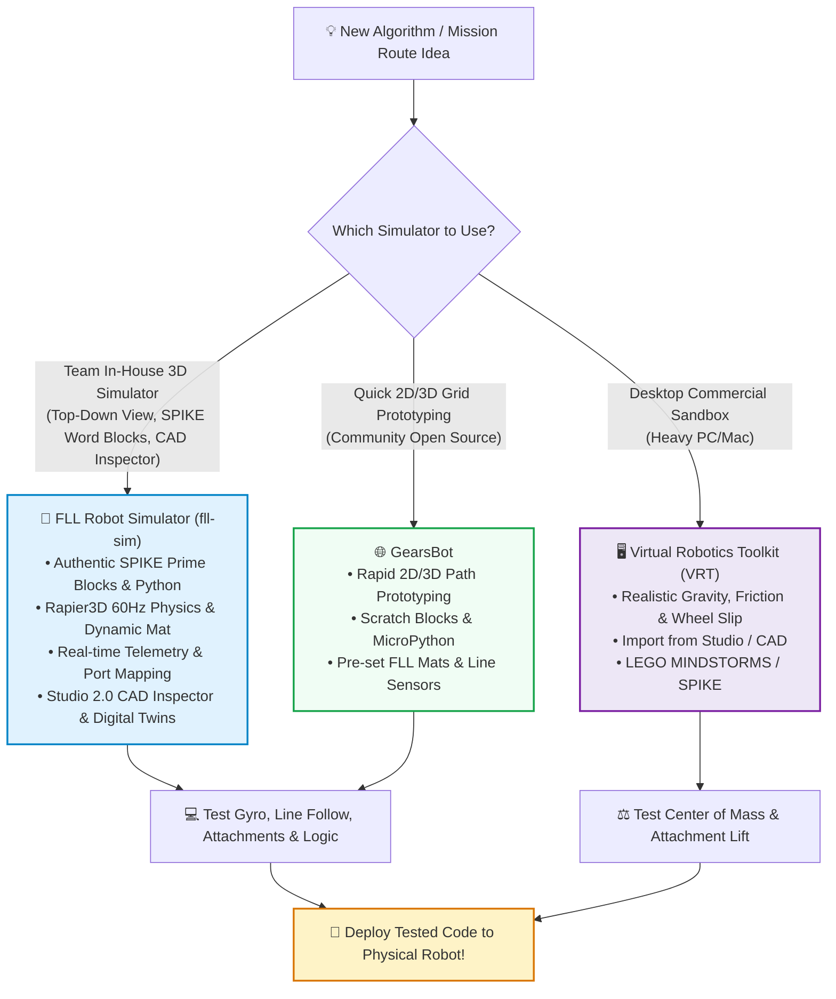
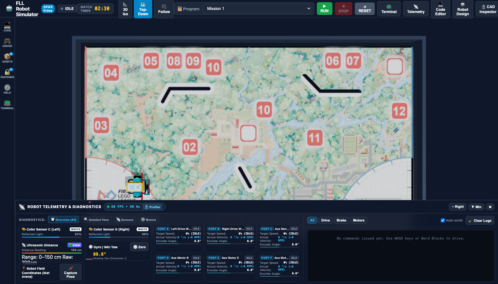
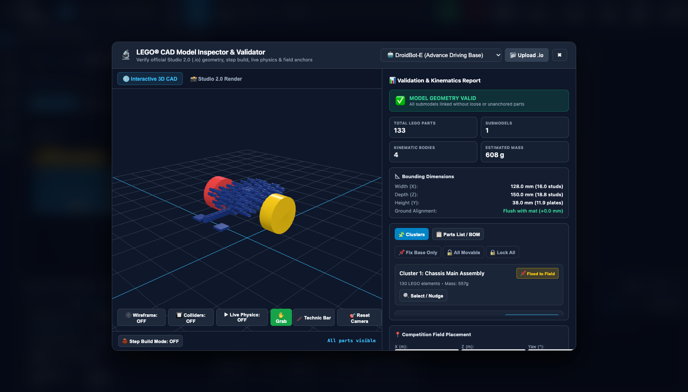
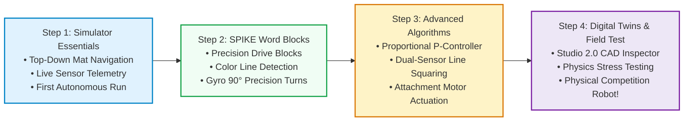

# 🎮 Advanced FLL Coding Tutorials, Simulators & Learning Hub — Lego Legends

> *"You don't need a physical robot in your hands 24/7 to become a world-class programmer."*

In FIRST LEGO League (FLL), our team has one competition mat and two SPIKE Prime driving bases, but **nine team members** who all want to build code and test mission algorithms. 

**Robot simulators and advanced tutorial platforms** solve this problem completely:
- Practice coding at home on any computer or Chromebook without taking the physical robot home.
- Test routing algorithms, gyro turns, and line-following logic in seconds.
- Rapidly prototype ideas without wearing down LEGO gears or draining Hub batteries.

Here are the top simulators, video courses, and programming resources recommended by FLL champions, coaches, and the global robotics community.

---

## 🕹️ Top FLL Robot Simulators

---

### 1. 🤖 Team FLL Robot Simulator (`fll-sim`) — In-House High-Precision Physics & SPIKE Studio

* **Official Live App:** [https://jaimeyu.github.io/fll_sim/](https://jaimeyu.github.io/fll_sim/)
* **Platform:** 100% Web Browser (Zero-install WebGL & WebAssembly — runs smoothly on Chromebooks, Mac, and PC).
* **Physics Engine:** Rapier3D Wasm at 60 Hz with compound pin clustering and high-friction mat kinematics.
* **Code Environments:** Authentic LEGO® SPIKE™ Prime Word Blocks Studio & Async Python Runtime (`from spike import PrimeHub, MotorPair, ColorSensor`).
* **Source & Documentation:** Included directly in this repository under `/fll-sim/`.

#### Why It's Our Team's Primary Training Ground:
Developed specifically for Team #76265 **Lego Legends**, `fll-sim` gives every student access to a virtual competition mat and digital twin driving bases:
- **Default Top-Down Alignment View**: View the 4×8 ft competition mat from directly overhead for precision line squaring, route planning, and mission alignment. Switch to 3D Isometric view anytime with orbiting camera controls.
- **Authentic SPIKE Prime Word Blocks Studio**: Popout 3-column modal featuring LEGO-authentic color-coded categories, block palette drawer, draggable canvas with zoom controls, multi-tab script zip export, and auto-saving.
- **Dockable Telemetry & Diagnostics**: Real-time readouts for Color Sensors C & D (reflected light %, RGB swatches), Ultrasonic Distance, 6-Axis Gyro IMU, and Motor Ports A–F (speed %, °/s, RPM, encoder angles) that dock to the bottom or right, or minimize to a compact 30px bar.
- **Robot Architecture & Hardware Port Matrix**: Switch between the Advanced Driving Base (DroidBot-E) and Compact SPIKE Base, or remap ports to match your physical robot's wiring.
- **3D CAD Model Inspector & Digital Twin Validator**: Load Studio 2.0 (`.io`) or LDraw (`.ldr`) robot and season mission models. Inspect pin clusters, rigid bodies, mass, and test physics with the virtual mouse grab hand and Technic push bar.

| SPIKE Word Blocks Studio | 3D CAD Model Inspector & Digital Twin |
|:---:|:---:|
|  |  |

---

### 2. 🌐 GearsBot — Fast, Browser-Based Prototyping

* **Official Live App:** [gears.aposteriori.com.sg](https://gears.aposteriori.com.sg/) (or GitHub Pages mirror: [quirkycort.github.io/gears](https://quirkycort.github.io/gears/))
* **GitHub Repository:** [QuirkyCort/gears](https://github.com/QuirkyCort/gears) (Active & Open Source, GPLv3)
* **Popular Pybricks Fork:** [kendmaclean/gears_pybricks](https://github.com/kendmaclean/gears_pybricks) (tailored for Pybricks MicroPython)
* **Platform:** 100% Web Browser (Chrome, Safari, Edge — runs great on Chromebooks and laptops).
* **Cost:** **Free & Open Source**.
* **Language Support:** Blockly / Scratch blocks (identical to the LEGO SPIKE App) and MicroPython.

#### Why FLL Teams Love It:
GearsBot is overwhelmingly the community favorite on Reddit (`r/FLL`) for quick algorithmic experimentation. Built on **Babylon.js** and physics engines, you can jump directly into a web browser, select a virtual robot configured with dual color sensors, ultrasonic sensors, and a gyro, drop it onto a competition-style mat, and run code immediately.

#### Best Used For:
- **Proportional Line Following:** Tuning P-controller constants without chasing a runaway robot across the room.
- **Line Squaring (Dual Sensor Alignment):** Testing the logic of stopping each wheel independently when it sees black.
- **Gyro Turn Accuracy:** Understanding how heading angle adjustments compensate for wheel slippage.
- **Homework & Solo Practice:** Teammates can test their mission route theories at home during the week.

> [!TIP]
> **Getting Started with GearsBot:**
> 1. Visit [gears.aposteriori.com.sg](https://gears.aposteriori.com.sg/) (or [quirkycort.github.io/gears](https://quirkycort.github.io/gears/)).
> 2. Click **Simulator** in the top bar.
> 3. Select an arena (e.g., Grid, Line Track, or custom mat image).
> 4. Switch between the **Blocks** tab (looks like SPIKE Scratch) or **Python** tab.
> 5. Click the green **Run** button to watch your code drive the virtual bot!

---

### 3. 🪐 Virtual Robotics Toolkit (VRT) — Physics-Based 3D Simulation

* **Website:** [virtualroboticstoolkit.com](https://www.virtualroboticstoolkit.com/)
* **Platform:** Windows PC and macOS (Desktop application).
* **Cost:** Free trial available; individual / classroom license.
* **Compatibility:** Integrates with LEGO Digital Designer (LDD), BrickLink Studio (`.ldr`/`.io`), and official LEGO programming environments.

#### Why Advanced Teams Use It:
While GearsBot excels at fast code logic, **Virtual Robotics Toolkit (VRT)** is a full physics sandbox. It simulates real-world friction, wheel torque, surface resistance, gravity, and attachment collisions.

#### Best Used For:
- **Custom Robot CAD Import:** You can design your robot in BrickLink Studio or our [3D CAD Studio](../webtools/mission_cad_studio.html), export the model, and load your *exact* physical design into VRT!
- **Weight Distribution & Center of Gravity:** See if high-mounted heavy attachments will cause your robot to tip when accelerating or stopping abruptly.
- **Complex Mission Model Physics:** Testing if a mechanical lever arm has enough torque to lift an FLL mission model weight before building it with real bricks.

---

### 📊 Simulator Comparison Matrix

| Feature | 🤖 Team Simulator (`fll-sim`) | 🌐 GearsBot | 🪐 Virtual Robotics Toolkit (VRT) |
| :--- | :--- | :--- | :--- |
| **Installation** | None (instant in-browser) | None (instant in-browser) | Desktop download (Win/Mac) |
| **Hardware Requirements** | Runs on anything (Chromebooks, laptops) | Runs on anything (Chromebooks, laptops) | Needs dedicated GPU/decent CPU |
| **Cost** | 100% Free & Open Source | 100% Free & Open Source | Commercial (Free trial available) |
| **Code Formats** | Authentic SPIKE Word Blocks, SPIKE Python | Scratch Blocks, MicroPython | LEGO MINDSTORMS, SPIKE, EV3 |
| **Physics Engine** | Rapier3D Wasm 60Hz + Pin Clustering | Babylon.js + Cannon/Ammo | Custom high-end physics engine |
| **Custom Model Import** | Direct Studio (`.io`) & LDraw (`.ldr`) import | Pre-set modular configurations | Studio (`.io`) & LDD import |
| **Digital Twin Validator** | Built-in CAD Inspector & Kinematics sandbox | None | Manual collision mapping |
| **Best For** | Official FLL mission practice, Word Blocks, CAD inspection | Quick 2D/3D line following, logic drills | Mechanical stress, heavy CAD validation |

---

## 🎓 Masterclass Tutorials & Course Platforms

Beyond simulators, these curated educational resources provide world-class tutorials specifically designed for FLL teams using SPIKE Prime.

---

### 3. 🎬 FLLCasts — Mission Masterclasses & Mechanical Guides

* **Website:** [fllcasts.com](https://www.fllcasts.com/)
* **Platform:** Online video tutorials, CAD building guides, and step-by-step courses.
* **Topics:** SPIKE Prime, Robot Inventor, attachment design, season mission walkthroughs.

#### What Makes It Great:
FLLCasts is a specialized online academy for FIRST LEGO League teams. They provide professional video breakdowns of:
- **Modular Attachment Mechanisms:** Drop-in, pin-less attachment mounts, passive ratchets, and gearbox multipliers.
- **Mission-by-Mission Strategy:** Deep tactical analysis of scoring density, distance-to-point efficiency, and return routes.
- **Sensors Deep Dives:** How to filter ambient light noise from color sensors and how to properly reset and calibrate the SPIKE Prime built-in gyro.

---

### 4. 🥇 PrimeLessons.org & EV3Lessons.org (Seshan Brothers)

* **Website:** [primelessons.org](https://primelessons.org/)
* **Platform:** 100% Free downloadable slides and guides.
* **Authors:** Sanjay & Arvind Seshan (World Champions, FLL Hall of Fame, *Not the Droids You Are Looking For*).

#### Why Every FLL Team Should Bookmark This:
PrimeLessons is considered the **gold standard curriculum** in competitive FLL. Their lessons are clear, free of fluff, and teach professional robotics software engineering concepts:
- **Gyro Straight Driving (Proportional P-Controller):** How to keep a robot driving in a laser-straight line even if the wheels slip or weight is uneven.
- **Line Squaring (Double Color Sensor):** The fundamental technique for aligning square against black boundary lines on the mat to eliminate odometry drift.
- **MyBlocks with Parameters:** How to write clean, reusable modular code blocks instead of copying and pasting huge blocks of code.
- **Reliability Engineering:** Practical advice on battery voltage consistency, wheel cleaning, and friction reduction.

---

### 5. ⚡ Pybricks — Next-Level MicroPython for SPIKE Prime

* **Website:** [pybricks.com](https://pybricks.com/)
* **Platform:** Web-based IDE communicating directly via Bluetooth to the SPIKE Prime Hub.
* **Cost:** Free & Open Source.

#### Why Advanced Teams Migrate to Pybricks:
As student coders outgrow Scratch blocks, Pybricks offers the fastest, most precise Python runtime for LEGO Hubs:
- **Built-in Acceleration Profiling:** Motors accelerate and decelerate smoothly without jarring or wheel skidding.
- **Native Gyro Integration:** Drive straight commands automatically use the internal IMU gyro under the hood without needing complex loops.
- **Instant Bluetooth Run:** Programs upload and execute in less than 1 second.

---

## 🗺️ Recommended Student Learning Roadmap

Where should a student coder start? Follow this 4-step progressive training pathway:

1. **Step 1 — Simulator Essentials (`fll-sim`):**
   - Launch the [3D Robot Simulator](https://jaimeyu.github.io/fll_sim/).
   - Follow **Tutorial 1: Navigating the 3D Mat & Your First Autonomous Run** to learn the 4×8 ft competition field, top-down view, and drive straight missions.
2. **Step 2 — SPIKE Prime Word Blocks Studio:**
   - Follow **Tutorial 2: Programming with LEGO SPIKE Prime Word Blocks**.
   - Build a precision drive and attachment mission using authentic LEGO Word Blocks.
   - Test gyro precision 90-degree turns and line stopping using the live telemetry dock.
3. **Step 3 — Master Autonomous Navigation Algorithms:**
   - Follow **Tutorial 3: Authentic SPIKE Python Programming & Autonomous Navigation**.
   - Implement proportional line following (P-controller) and dual-sensor line squaring using Color Sensors C & D.
   - Follow **Tutorial 4: Robot Architecture, Hardware Port Mapping & Calibration** to match your team's robot build.
4. **Step 4 — Digital Twin Inspection & Competition Table Validation:**
   - Follow **Tutorial 5: 3D CAD Model Inspector & Studio 2.0 Digital Twins**.
   - Load and validate your team's BrickLink Studio (`.io`) robot model in the Rapier3D physics sandbox.
   - Deploy your verified code to Team 76265's physical robot on the real mat with 100% confidence!

---

## 🔗 Quick Resource Directory

| Resource | Category | Link | Access |
| :--- | :--- | :--- | :--- |
| **Team 3D Robot Simulator (`fll-sim`)** | Web Simulator | [Live Simulator](https://jaimeyu.github.io/fll_sim/) | Free (In Repo) |
| **Tutorial 1: Navigating 3D Mat** | Simulator Guide | [Tutorial 1](https://jaimeyu.github.io/fll_sim/tutorials/01_getting_started/) | Free (In Repo) |
| **Tutorial 2: SPIKE Word Blocks** | Programming | [Tutorial 2](https://jaimeyu.github.io/fll_sim/tutorials/02_word_blocks_programming/) | Free (In Repo) |
| **Tutorial 3: Authentic SPIKE Python** | Autonomous Algorithms | [Tutorial 3](https://jaimeyu.github.io/fll_sim/tutorials/03_python_programming/) | Free (In Repo) |
| **Tutorial 4: Robot Architecture & Ports** | Hardware Mapping | [Tutorial 4](https://jaimeyu.github.io/fll_sim/tutorials/04_robot_design_and_ports/) | Free (In Repo) |
| **Tutorial 5: 3D CAD Model Inspector** | Digital Twins & Physics | [Tutorial 5](https://jaimeyu.github.io/fll_sim/tutorials/05_cad_inspector_digital_twins/) | Free (In Repo) |
| **Simulator UI Component Reference** | Documentation | [UI Reference](https://jaimeyu.github.io/fll_sim/ui/components/) | Free (In Repo) |
| **GearsBot Simulator** | Web Simulator | [gears.aposteriori.com.pt](https://gears.aposteriori.com.pt/) | Free |
| **Virtual Robotics Toolkit** | 3D Physics Simulator | [virtualroboticstoolkit.com](https://www.virtualroboticstoolkit.com/) | Free Trial / Paid |
| **PrimeLessons.org** | Lessons & Code | [primelessons.org](https://primelessons.org/) | Free |
| **FLLCasts** | Courses & Missions | [fllcasts.com](https://fllcasts.com/) | Free / Subscription |
| **Pybricks** | Advanced Python | [pybricks.com](https://pybricks.com/) | Free |
| **FIRST Inspires Resource Library** | Official Rules & Updates | [firstinspires.org](https://www.firstinspires.org/resource-library/fll/challenge/competition-resources) | Free |
| **FLL Tutorials & Strategy** | Strategy & Judging | [flltutorials.com](https://flltutorials.com/) | Free |
| **Team 3D CAD Studio** | Local Web Tool | [3D CAD Studio](../webtools/mission_cad_studio.html) | Free (In Repo) |
| **Team Match Practice Timer** | Local Web Tool | [Interactive Timer](../webtools/index.html) | Free (In Repo) |

