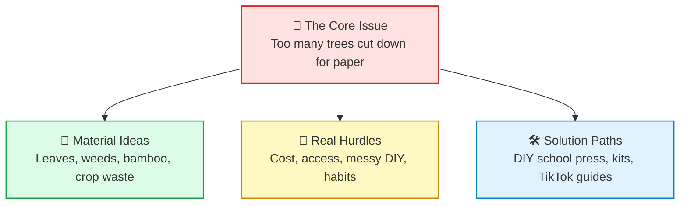

# 🌲 Innovation Project Homework: Tree-Free Paper & Deforestation Solutions
### FLL Team #76265 "Lego Legends" • Season 2026: BIOGLOW

!!! info "🖨️ Printable & Digital Student Homework Sheet"
    Prefer to fill this out online or print a clean copy for your team binder?  
    [📄 Open Printable & Interactive Homework Sheet &rarr;](session_6_homework.html)

<div align="center">
  
</div>

---

## 📋 Student & Strike Team Information

```text
Student Name  : _________________________________________________   Date: ________________________
Strike Team   : [ ] 🔨 Builders (Prototypes)   [ ] 🔬 Researchers (Facts)   [ ] 📢 Marketers (Pitches)
Project Due   : Next Team Session (Sunday @ 1:00 PM)
```

---

## 🎯 The Mission Brief: Why Are We Doing This?

Trees are the lungs of planet Earth! They give us clean oxygen, soak up carbon dioxide, and provide homes for millions of birds, bugs, and woodland animals. But every single day, **millions of live trees are cut down just to make paper products** (like notebooks, cardboard boxes, and paper towels).

In **Session 6**, our team asked a giant question:  
> **"Can we make writing, drawing, and paper products WITHOUT destroying living trees?"**

Your mission for this homework is to be an **Innovation Detective**:
1. Review the **Team Brainstorm Spark Bank** below for ideas.
2. Choose **ONE specific problem** you care about.
3. Explain **why it is good to solve**.
4. Describe **your creative solution** (with a sketch!).
5. Explain **why your solution helps our problem**.

---

## 💡 Team Brainstorm Spark Bank (Quick Notes from Session 6)

*Need inspiration? Here is a quick summary of the ideas and puzzles our team explored in our whiteboard brainstorm:*



### 1. 🌲 Why Cutting Trees is a Problem
* **Ecosystem Damage:** Destroys animal shelters, harms forest biodiversity, and lowers fresh oxygen.
* **Heavy Resource Usage:** Making standard paper from wood pulp uses tons of water, heat, and harsh bleaching chemicals.

### 2. 🌾 Local & Fast-Growing Plant Ideas (No Trees Needed!)
* **Fallen Leaves & Yard Clippings:** Autumn leaves, garden weeds, and lawn grass that are already raked up.
* **Crop Stalks & Agricultural Leftovers:** Leftover wheat straw and canola plants from local prairie farms.
* **Super-Fast Growers:** Bamboo (grows up to 3 feet per day!) or marine seaweed / ocean kelp.
* **Herbivore Plant Fibers:** Natural grass manure from plant-eating farm animals (already digested plant fibers!).

### 3. 🚧 The Tough Hurdles We Need to Overcome
* **Accessibility:** Digital pens and laptops cost money, need batteries, and can break. Real paper is still needed!
* **Messy & Slow:** Making homemade paper in a blender can be watery, drippy, and sticky without the right tools.
* **Knowledge Gap:** People don't know that leaves or weed fibers can turn into real, smooth writing paper.
* **High Daily Use:** Schools, offices, and homes use paper for worksheets, art, and packaging every single day.

---

## 📝 Student Worksheet: Fill In Your Big Idea!

*Complete the 4 steps below. Write clearly and don't worry about being perfect—creative and bold ideas are the best!*

---

### Step 1: 🎯 Identify the Problem You Want to Solve

Which specific challenge do you want our team to tackle?  
*(You can check one box below OR write your own!)*

- [ ] **Option A:** Too many trees are chopped down for school worksheets and notebook paper.
- [ ] **Option B:** People don't have access to easy, local alternative materials (like fallen leaves or weed stalks).
- [ ] **Option C:** Making alternative paper is too messy, takes too long, or is hard to do at home/school.
- [ ] **Option D:** Tree-free paper or electronic tablets are too expensive for families and schools.
- [ ] **Option E (My Own Problem Idea):** __________________________________________________________________

**Write your exact Problem Statement in your own words:**  
*(Hint: "The problem I want to solve is...")*

```text
The problem I want to solve is:
__________________________________________________________________________________________________
__________________________________________________________________________________________________
__________________________________________________________________________________________________
```

---

### Step 2: 🌍 Why It Is Good to Solve

Why is fixing this problem important? Who or what does it help?  
*(Think about: trees, forest animals, our school, water conservation, or our city!)*

> 💡 **Coach Tip:** Judges love knowing who benefits! For example: *"This saves 50 trees in our neighborhood and keeps owl nesting habitats safe!"*

```text
Why it is good to solve:
1. It helps the environment / community because:
   _______________________________________________________________________________________________
   _______________________________________________________________________________________________

2. What happens if we DO NOT fix this problem?
   _______________________________________________________________________________________________
   _______________________________________________________________________________________________
```

---

### Step 3: 💡 My Creative Solution Idea

What is your invention, process, or tool? How does it work?  
*(Is it a leaf-pressing tool? A school DIY paper-making kit? A new recipe using weeds or canola? An awareness app?)*

```text
My Solution Idea Name: ___________________________________________________________________________

How it works (step-by-step):
1. _______________________________________________________________________________________________
2. _______________________________________________________________________________________________
3. _______________________________________________________________________________________________
```

#### ✏️ Quick Sketch / Blueprint Pad
*Draw a picture or blueprint of your invention, tool, or how your alternative paper is made:*

```text
+------------------------------------------------------------------------------------------------+
|                                                                                                |
|                                                                                                |
|                                                                                                |
|                                 [ DRAW YOUR IDEA HERE ]                                        |
|                          (Labels, arrows, and LEGO parts welcome!)                             |
|                                                                                                |
|                                                                                                |
|                                                                                                |
+------------------------------------------------------------------------------------------------+
```

---

### Step 4: 🚀 Why This Solution Helps Our Problem

How does your solution actually fix or improve the problem from Step 1? Why does your idea work better than what people do today?

```text
Why this solution helps our problem:
__________________________________________________________________________________________________
__________________________________________________________________________________________________
__________________________________________________________________________________________________
__________________________________________________________________________________________________
```

---

## 🤝 Team "Plus'ing" Collaboration Corner

> 🌟 **FIRST Core Value:** *Innovation & Teamwork!* In Session 7, you will pair up with a teammate to **"Plus (+)"** each other's ideas.

*Write down one question or idea you want to ask your team partner next Sunday:*

```text
"Hey teammate, what do you think would happen if we added: _______________________________________
_________________________________________________________________________________________________"
```

---

## 🏁 Homework Completion Checklist

Before packing this sheet in your team binder, double check:
- [ ] I wrote my name and selected my Strike Team.
- [ ] I picked a specific problem in Step 1.
- [ ] I explained who and what it helps in Step 2.
- [ ] I explained my solution idea and drew a sketch in Step 3.
- [ ] I explained why my solution solves the problem in Step 4.
- [ ] I am ready to share my 1-minute pitch at our next team meeting!

---

## 🔗 Related Team Resources & Guides

* 📄 [Interactive & Printable HTML Worksheet](session_6_homework.html)
* 🌲 [Deforestation Solutions Full Interactive Worksheet](deforestation_project_worksheet.html)
* 💡 [Innovation Project & Biomimicry Planner](innovation_project_worksheet.html)
* 📋 [Pokémon CRM Run Card Guide](crew_resource_management_kids.html)
* 😤 [Frustration Buster & Calm Down Guide](frustration_checklist_kids.html)
