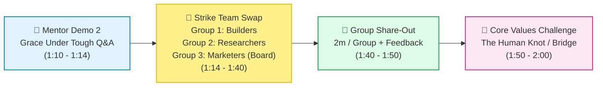

# FLL Session 6 (Sprint Session 2): Strike Team Swap, Logo Vote & Combining Robot Missions — Lego Legends

**Date:** Sunday, November 1, 2026  
**Time:** 1:00 PM – 4:00 PM (180 Minutes)  
**Attendees:** Team Members (9 Kids), Mentors & Coaches  
**Season Phase:** Competition Build Sprint Phase — Cross-Training, Board Layout & Run Combination  

> [!IMPORTANT]
>
> ### 🧭 Coaching Architecture: Cross-Pollinating Talents & Chaining Mission Runs
>
> In Session 5, the team launched specialized strike teams and established mission benchmarks. Today, we execute a deliberate **cross-pollination swap**: students rotate into completely different Innovation strike teams so everyone develops empathy, multifaceted ownership, and a 360-degree grasp of our project.
>
> 1. **Strike Team Rotation (1:10 – 2:00 PM):** Builders shift to Research, Researchers shift to Marketing, and Marketers shift to Physical Building. The Marketers now focus heavily on presentation trifold layout and visual hierarchy.
> 2. **Final Logo Vote (2:00 – 2:10 PM):** Cast official ballots on the revised digital logo designs to lock in our team identity for shirts, swag, and presentation boards.
> 3. **Run Optimization Sprint (2:20 – 3:50 PM):** Shift from testing isolated missions to **combining missions into continuous runs** (e.g., Run 1 combining M01 + M03, Run 2 combining M02 + M04). Eliminating table trips is the fastest way to gain match points!

---

## 📌 Coach's Prep & Materials Checklist

* **Innovation Project Materials:**
  * Trifold presentation display board (white cardboard base) and layout planning templates.
  * Cardstock, glue sticks, scissors, colored markers, and sticky notes.
  * Completed research note cards and physical prototype models from Oct 25.
  * Timer display visible from all team stations.
* **Team Identity Materials:**
  * Printed or digital display of the final revised logo candidates (Options A, B, C).
  * Secret ballot slips or voting tokens for all 9 students.
* **Robot Game Station:**
  * Official BIOGLOW mat with all mission models aligned and secured.
  * 2 SPIKE Prime robots with fresh battery packs + spare wheels and attachment frames.
  * [Scoring Calculator](../../../webtools/bioglow_calculator.html) open for live multi-run scoring.
  * Stopwatch for timing transition intervals between runs in the home launch area.

---

## 🕒 Master Timeline Overview (1:00 PM – 4:00 PM • 180 Min)

```mermaid
gantt
    title Session 6 Timeline (Sunday, Nov 1 • 180 Minutes)
    dateFormat HH:mm
    axisFormat %H:%M

    section Kickoff
    Arrival, Stand-Up & Goal Check :13:00, 10m

    section Innovation
    Mentor Demo (Tough Q&A)        :13:10, 4m
    Strike Team Swap Breakouts     :13:14, 26m
    Present Findings & Board Layout:13:40, 10m
    Core Values Team Challenge     :13:50, 10m

    section Identity
    Final Team Logo Vote           :14:00, 10m

    section Recharge
    Bio Break & Snack Reset        :14:10, 10m

    section Robot Game
    Mission Combination Sprints    :14:20, 90m

    section Wrap-Up
    Pack-Up & Core Values Circle   :15:50, 10m
```

---

## 📋 Minute-by-Minute Session Plan

### 1:00 – 1:10 PM | Arrival, Stand-Up & Kickoff (10 min)

* **Welcome & Warm-Up (3 min):** Greet students at the door. Check energy levels and assign station badges.
* **Stand-Up Review & Daily Focus (7 min):**
  * Highlight the countdown: *4 sessions left until November 29!*
  * **Today's Big Objective:** Cross-train! Everyone works in a new domain today so our team has zero single-point dependencies.
  * Review role coordination with **Machamp** (Timer Lead) and **Psyduck** (Inclusion & Conflict Monitor).

---

### 1:10 – 2:00 PM | Block 1: Innovation Project (50 min)

#### 1. Mentor Demo: Handling Unfamiliar Judge Questions (1:10 – 1:14 PM • 4 min)
* Two mentors deliver a rapid 2-minute pitch modeling a realistic tournament scenario:
  * Mentor A poses as an inquisitive judge: *"How does your solution compare to commercial drone seed planters that already exist in Canada?"*
  * Mentor B models an authentic response: acknowledging existing technology, clearly distinguishing our team's unique advantage (biodegradable natural casing + rodent repellent), and calmly admitting when an exact cost metric is still being researched (*"We are actively modeling that with our budget lead!"*).

#### 2. Strike Team Swap Breakouts (1:14 – 1:40 PM • 26 min)
Students rotate into their new assignments:

* **Group 1: The Builders (Iterating the Physical Prototype)**
  * *New Crew:* Students who were Researchers/Marketers last week.
  * *Focus:* Take the initial rough prototype from Session 5 and refine its durability, scale, and visual appeal. Can a judge hold it safely? Can its mechanism operate smoothly?
  * *Deliverable:* A finished, tactile prototype ready for table demonstration.

* **Group 2: The Researchers (Impact Metrics & Implementation Roadmap)**
  * *New Crew:* Students who were Builders last week.
  * *Focus:* Calculate the concrete impact numbers (e.g., *"If 100 hikers plant 5 pods each season, 500 new saplings take root across damaged trail boundaries"*).
  * *Deliverable:* A clear 3-step implementation roadmap (Design $\rightarrow$ Local Pilot $\rightarrow$ Community Scaling).

* **Group 3: The Marketers (Presentation Board Layout & Visual Hierarchy)**
  * *New Crew:* Students who were Builders/Researchers last week.
  * *Focus:* Map out the actual physical trifold presentation board:
    * Left Panel: The Problem (Deforestation stats, photos, local ecosystem context).
    * Center Panel: Our Solution & Prototype (Diagrams, features, how it works, catchy title).
    * Right Panel: Community Impact, Expert Interviews & Team Journey.
  * *Deliverable:* A full-size pencil wireframe sketch pinned onto the trifold board.

#### 3. Present Findings (1:40 – 1:50 PM • 10 min)
* 2 minutes per team + 1 minute of mentor and peer feedback.
* **Rule:** Every student speaks. New members articulate their group's progress with pride.

#### 4. Team Challenge: Core Values Activity (1:50 – 2:00 PM • 10 min)
* **The "Blind Direction" Building Challenge:**
  * One student is blindfolded; two teammates may only give 1-word verbal instructions to guide them in assembling 4 interlocking Technic pieces.
  * *Coaching takeaway:* Active listening, extreme communication clarity, and calm patience under pressure.

---

### 2:00 – 2:10 PM | Block 2: Team Identity — Final Logo Vote (10 min)

* **Display the Final Contenders:** Present the 3 polished digital candidates reflecting Session 5's feedback.
* **Secret Ballot Vote:** Every team member and mentor casts 1 token into the voting cups.
* **Announcement & Applause:** Reveal the winning official **Lego Legends** logo!
* **Action Item:** Logo file is locked for shirt printing, flyer headers, and swag stickers.

---

### 2:10 – 2:20 PM | Bio Break, Snack & Physical Reset (10 min)

* Hands off keyboards. Hydrate and eat a snack.
* Set up robot workstations for multi-mission run planning.

---

### 2:20 – 3:50 PM | Block 3: Robot Game — Mission Combination Sprints (90 min)

> 💡 **Strategic Focus: Chaining Missions into Single Runs**  
> Leaving the home launch area, completing one mission, and returning to base wastes 20–30 seconds of travel time. Chaining two or three nearby missions into a single outing drastically increases our point yield!

```mermaid
flowchart TD
    subgraph Run1["Run 1: West Coast Sprint"]
        M01["M01: Drone Survey (30 pts)"] --> M03["M03: Flip the Rock (30 pts)"]
        M03 --> Return1["Return to Home Launch Area"]
    end

    subgraph Run2["Run 2: Canopy & Forest Launch"]
        M02["M02: Exploding Seeds (30 pts - 3 Seeds)"] --> M04["M04: Lucky Leaves (30 pts)"]
        M04 --> Return2["Return to Home Launch Area"]
    end

    subgraph Run3["Run 3: Reef & Marine Path"]
        M11["M11: Artificial Reef (20 pts)"] --> M13["M13: Coral Nursery (20 pts)"]
        M13 --> Return3["Return to Home Launch Area"]
    end

    style Run1 fill:#e0f2fe,stroke:#0284c7,stroke-width:1.5px;
    style Run2 fill:#fef08a,stroke:#eab308,stroke-width:1.5px;
    style Run3 fill:#dcfce7,stroke:#16a34a,stroke-width:1.5px;
```

#### Squad Breakdown & 15-Minute Role Rotations
Continue working across Teams A, B, and C with regular 15-minute role rotations:

* **Team A (Chaining Run 1 — M01 + M03 + Return):**
  * *Goal:* Program the robot to push the scan marker for M01 (Drone Survey), pivot smoothly, drop the flag / flip the rock for M03, and drive backwards into home base.
  * *Target Points:* **60 points** in under 35 seconds!
  * *Reliability Benchmark:* 4 out of 5 clean executions.

* **Team B (Chaining Run 2 — M02 + M04):**
  * *Goal:* Drive out toward M02 (Exploding Seeds), trigger the stalk to eject all 3 seeds (30 points!), continue forward to push or flip M04 (Lucky Leaves - 30 points), and return.
  * *Target Points:* **60 points** in under 45 seconds!
  * *Reliability Benchmark:* Verify that triggering M02 does not jam the chassis or deflect the robot's heading before reaching M04.

* **Team C (Scouting & Attachment Quick-Swaps):**
  * *Goal:* Design attachment clips that allow the drive team to switch attachments in under **5 seconds** between runs.
  * *Focus:* Prototype passive guides for M11, M13, or M14 so Run 3 can be locked in during Session 7.

---

### 3:50 – 4:00 PM | Wrap-Up, Clean-Up Sprint & Reflection (10 min)

* **Clean-Up Sprint (5 min):**
  * All robots docked with power cords attached (**Meowth** monitors).
  * Trifold board components filed in project folder (**Machamp** leads).
  * Mat cleared of stray elements and inspected for tournament readiness.
* **Circle Reflection (5 min):**
  * Share one insight about what changed when swapping to a new strike team today.
  * Coach preview of Session 3: moving from planning into scriptwriting and team swag!

---

## 🎯 Coach's Success & Evaluation Criteria

- [ ] Every student successfully worked in a different Innovation strike team than in Session 5.
- [ ] Trifold presentation board layout wireframe mapped out with clear section headings.
- [ ] Official team logo selected via democratic team vote.
- [ ] Team A successfully executed a combined test of Run 1 (M01 + M03) on the competition mat.
- [ ] Team B successfully triggered M02's 3-seed release during a continuous drive run.
- [ ] Quick-swap attachment mechanism tested and timed under 10 seconds.
- [ ] All equipment accounted for, cleaned up, and charging.
