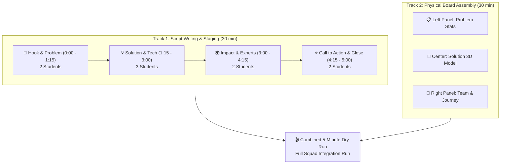
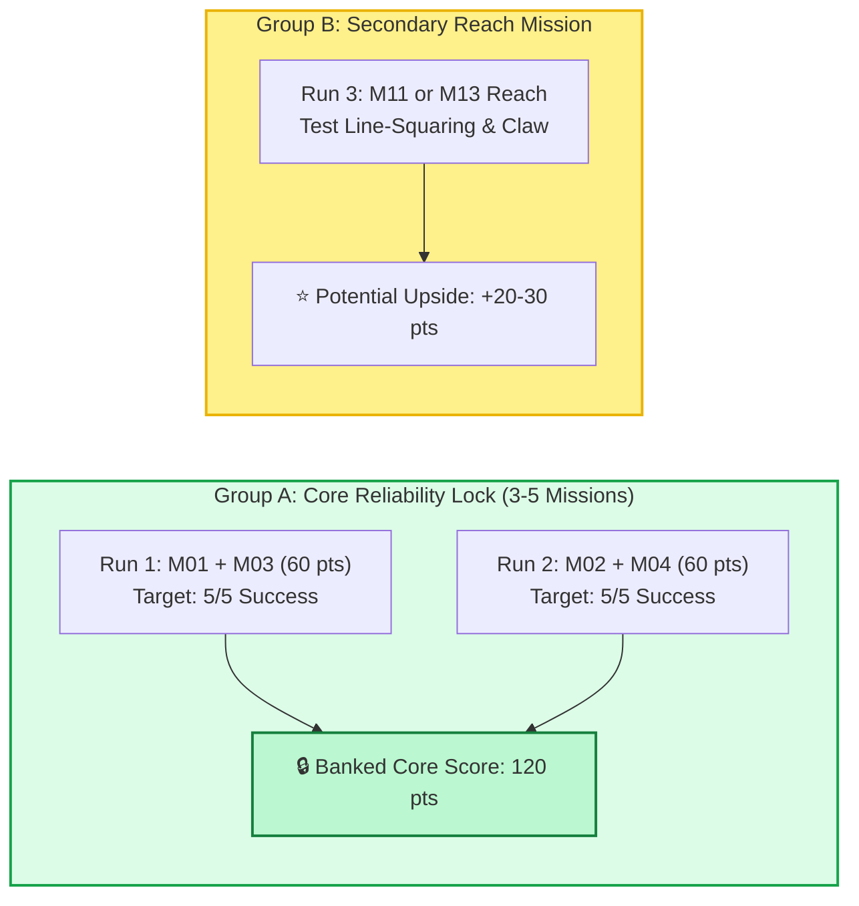

# FLL Session 7 (Sprint Session 3): Script Drafting, Presentation Board Build, Swag & Core Mission Logic — Lego Legends

**Date:** Sunday, November 8, 2026  
**Time:** 1:00 PM – 4:00 PM (180 Minutes)  
**Attendees:** Team Members (9 Kids), Mentors & Coaches  
**Season Phase:** Competition Build Sprint Phase — Presentation Creation, Swag Production & Core Mission Locking  

> [!IMPORTANT]
>
> ### 🧭 Coaching Architecture: Shifting from Writing into Physical Creation
>
> We are now **3 weeks away from the November 29 competition showcase**! Research and brainstorming are formally complete. Today, we shift 100% of our Innovation energy from writing into tangible creation: building the presentation script, mounting the physical trifold board, and manufacturing team swag.
>
> 1. **Innovation Presentation Build (1:10 – 2:10 PM • 60 min):** Draft the full 5-minute presentation script with assigned speaking lines, glue final visual assets onto the trifold board, and mount 3D prototype components.
> 2. **Team Swag Finalization & Production (2:10 – 2:30 PM • 20 min):** Select our official giveaway swag (buttons, vinyl stickers, 3D printed keychains) and assign production responsibilities to families.
> 3. **Core Mission Reliability Lock (2:50 – 3:50 PM • 60 min):** Group A locks in our top 3–5 high-reliability missions (>90% success rate), while Group B finalizes logic for one high-value secondary/reach mission.

---

## 📌 Coach's Prep & Materials Checklist

* **Innovation Presentation Materials:**
  * Master trifold presentation board (prepped from Session 6 wireframe).
  * Color-printed photos, diagrams, title headers, and quotes.
  * Spray adhesive, glue dots, cardstock backings, and clear tape.
  * Blank script template printed with columns for *Speaker*, *Visual Prop / Action*, and *Spoken Words*.
* **Team Swag Materials:**
  * Sample button-maker kit, badge parts, stickers, and keychain blanks.
  * Cost estimate worksheet and parent assignment sheet.
* **Robot Game Station:**
  * Official BIOGLOW mat and dual SPIKE Prime robots.
  * Whiteboard to track mission consistency scores (Target: 5 consecutive successful runs).
  * Stopwatches and [Interactive Scoring Calculator](../../../webtools/bioglow_calculator.html).

---

## 🕒 Master Timeline Overview (1:00 PM – 4:00 PM • 180 Min)

```mermaid
gantt
    title Session 7 Timeline (Sunday, Nov 8 • 180 Minutes)
    dateFormat HH:mm
    axisFormat %H:%M

    section Kickoff
    Arrival & 3-Week Goal Briefing :13:00, 10m

    section Innovation Build
    Draft Script & Build Board (60m) :13:10, 60m

    section Identity & Swag
    Finalize Swag & Assign Tasks   :14:10, 20m

    section Core Values
    Team Challenge Activity        :14:30, 10m

    section Recharge
    Bio Break & Snack Reset        :14:40, 10m

    section Robot Game
    Lock Core Missions (Group A)   :14:50, 60m
    Finalize Reach Mission (Group B):14:50, 60m

    section Wrap-Up
    Pack-Up & Core Values Circle   :15:50, 10m
```

---

## 📋 Minute-by-Minute Session Plan

### 1:00 – 1:10 PM | Arrival, Stand-Up & Kickoff (10 min)

* **Welcome & Gear Check (3 min):** Fast student check-in. Put phones/tablets away except for assigned presentation devices.
* **Stand-Up Alignment (7 min):**
  * Emphasize the milestone: *Today we produce our physical deliverables! At 4:00 PM today, our presentation board will be assembled and our script will have names next to every line!*
  * Review roles: **Machamp** (Presentation Lead) co-facilitates the script workshop; **Meowth** logs swag budgets; **Greninja** manages table run records.

---

### 1:10 – 2:10 PM | Block 1: Innovation Project — Shift from Writing to Creating (60 min)

#### Parallel Workstreams (First 45 min):
Students divide based on preferences while ensuring all 9 have active roles:

* **Script Writing & Blocking Crew (4–5 students):**
  * *Lead:* **Machamp** (Presentation Lead) & **Alakazam** (Research Lead).
  * Structure the 5-minute presentation into 4 distinct acts:
    1. **Act 1: The Hook (0:00 – 1:15):** Dramatic opening demonstrating the habitat crisis (deforestation, seed mortality) using a sound effect or visual prop.
    2. **Act 2: The Invention (1:15 – 3:00):** Reveal the physical prototype. Explain materials, mechanics, and why existing tools fail.
    3. **Act 3: The Validation (3:00 – 4:15):** Share feedback from our biologist and community interviews. Show survey charts and test data.
    4. **Act 4: The Impact & Call to Action (4:15 – 5:00):** What happens when our solution is deployed across Canada? Powerful closing cheer!
  * **Critical Rule:** Every single student must have between **25 and 45 seconds of speaking time**. Write students' names directly beside each paragraph.

* **Trifold Board & Visual Props Crew (4–5 students):**
  * *Lead:* **Tinkaton** (Prototype Lead) & **Jigglypuff** (Creative Director).
  * Affix high-contrast lettering and titles using our official team colors.
  * Secure the physical seed pod prototype to a mounted display shelf on the center board.
  * Create interactive elements: pull-tabs, flip-cards showing "Before & After" ecosystem stats, and a QR code linking to our online project documentation.

#### Full Squad Script Read-Through (Final 15 min • 1:55 – 2:10 PM):
* Stand around the completed board.
* Read through the draft script from beginning to end with a stopwatch running.
* Check total time: target is **4 minutes 30 seconds** (leaving a 30-second buffer before the strict 5:00 buzzer!).

---

### 2:10 – 2:30 PM | Block 2: Team Identity & Swag Finalization (20 min)

* **Swag Selection & Samples (10 min):**
  * Review sample items featuring our official winning logo:
    * **1.25" Pinback Buttons:** Inexpensive, fun to trade with other teams at the pit tables.
    * **Die-Cut Vinyl Stickers:** High-quality stickers for notebooks, laptops, and robot crates.
    * **3D-Printed Lego Legends Keychains:** Unique custom giveaway designed in Tinkercad.
  * Team reaches consensus on our swag package (e.g., 50 buttons + 50 stickers for pit trading).
* **Task & Supply Assignments (10 min):**
  * Record who is bringing/making what (**Dragonite** and **Meowth** coordinate):
    * Family A: Prints button inserts on cardstock.
    * Family B: Operates button press machine.
    * Mentors: Order vinyl stickers and supply lanyard ribbons.

---

### 2:30 – 2:40 PM | Team Challenge: Core Values Activity (10 min)

* **The "Pass the Core Value" Balloon Tap Challenge:**
  * The team keeps 2 balloons in the air simultaneously. Each time a student taps a balloon, they must name one way our team practiced a FIRST Core Value (Discovery, Innovation, Impact, Inclusion, Teamwork, Fun) today.
  * If a balloon touches the floor, celebrate the effort, reset, and try for a higher streak!
  * *Coaching takeaway:* Joyful physical movement, mutual support, and spontaneous verbal celebration.

---

### 2:40 – 2:50 PM | Bio Break, Snack & Transition (10 min)

* Hand-washing, water refill, and snack.
* Power on robots and clear the table for mission tuning.

---

### 2:50 – 3:50 PM | Block 3: Robot Game — Core Mission Locking (60 min)

> 💡 **Strategic Focus: Securing the "Bankable" Points**  
> Teams often lose tournaments by chasing 6 mediocre missions that fail 50% of the time. We win by locking in 3–5 missions that are mathematically rock-solid, then testing one reach mission as bonus upside!

#### Group Assignments:
* **Group A: Core Mission Consistency (4–5 students):**
  * *Assigned Runs:* **Run 1** (M01 Drone Survey + M03 Flip the Rock) and **Run 2** (M02 Exploding Seeds + M04 Lucky Leaves).
  * *Task:* Run each program 5 times in a row without making code changes.
  * *Tuning:* If the robot drifts, adjust wheel starting jigs, clean tires with alcohol wipes, or calibrate gyro angle drift.
  * *Goal:* Achieve at least **4 out of 5 perfect completions** for each core run.

* **Group B: Secondary / Reach Mission Optimization (4–5 students):**
  * *Assigned Run:* **Run 3** (Testing M11 Artificial Reef or M13 Coral Nursery).
  * *Task:* Finalize claw attachment geometry, test entry speed, and write a clean recovery routine if the attachment catches on a model.
  * *Goal:* Determine whether Run 3 is stable enough to include in our official 2:30 match plan.

---

### 3:50 – 4:00 PM | Wrap-Up, Clean-Up Sprint & Reflection (10 min)

* **Clean-Up Sprint (5 min):**
  * Safely mount presentation board on wall or protective carrying box.
  * Store all script copies in team binder sleeve (**Machamp**).
  * Dock SPIKE hubs and store cables in electronics bin (**Meowth**).
* **Circle Reflection (5 min):**
  * Celebrate having a real, physical presentation board built!
  * Announce next week's milestone: **Session 4 Mid-Month Checkpoint & Full Script Rehearsal**!

---

## 🎯 Coach's Success & Evaluation Criteria

- [ ] Complete 5-minute presentation script written with individual speaking lines assigned to every student.
- [ ] Physical trifold board populated with problem data, solution diagrams, and mounted prototype.
- [ ] Swag plan confirmed (buttons + stickers) with parent volunteers assigned to materials and production.
- [ ] Core mission runs (Run 1 & Run 2) verified on the table with repeatable success.
- [ ] Secondary reach mission analyzed with clear go/no-go criteria established for next week.
- [ ] Clean-up finished promptly with all materials safely stored.
