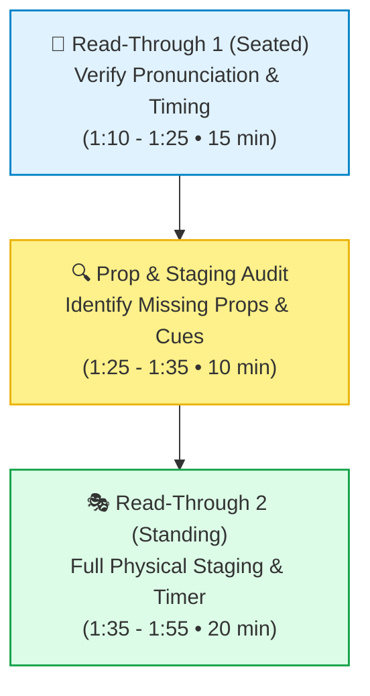
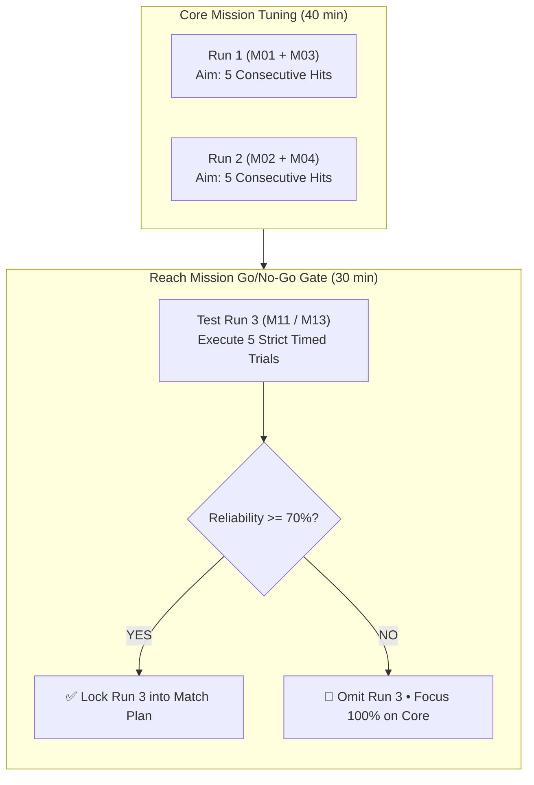

# FLL Session 8 (Sprint Session 4): Mid-Month Checkpoint, Full Script Read-Through & Flex Buffer — Lego Legends

**Date:** Sunday, November 15, 2026  
**Time:** 1:00 PM – 4:00 PM (180 Minutes)  
**Attendees:** Team Members (9 Kids), Mentors & Coaches  
**Season Phase:** Competition Build Sprint Phase — Mid-Month Checkpoint, Script Memorization & Catch-Up Flex  

> [!IMPORTANT]
>
> ### 🧭 Coaching Architecture: The Critical Mid-Month Sanity Check
>
> We are exactly **two weeks away from tournament day (November 29)**! Mid-season projects often experience "feature creep"—trying to add too many new ideas at the last second. Today is our structured **sanity and calibration checkpoint**:
>
> 1. **Innovation Script Read-Through & Prop Audit (1:10 – 1:55 PM • 45 min):** Perform multiple full-team standing read-throughs of the 5-minute presentation script. Clarify speaking handoffs, verify timing, and generate a missing-props punch list.
> 2. **Dedicated Robot Tuning (2:15 – 3:25 PM • 70 min):** Deep tuning of our 3–5 core missions. Final decision on whether the secondary reach mission makes the official tournament run order.
> 3. **The 25-Minute Flex Buffer (3:25 – 3:50 PM):** Built-in buffer time! We do not schedule new tasks here—instead, the team deploys to catch up on whichever deliverable (swag, board polishing, script tweaks, or code reliability) is lagging behind.

---

## 📌 Coach's Prep & Materials Checklist

* **Presentation Audit Checklist:**
  * Printed script copies on clipboards with highlighted lines for all 9 kids.
  * Master punch-list whiteboard: *Missing Props, Staging Issues, Speaking Pace, Eye Contact*.
  * Big digital display timer set to 5:00 countdown.
* **Robot Tuning Materials:**
  * Clean field mat (vacuumed and wiped down).
  * Robot inspection box / sizing jig (verifying robot + all attachments fit inside the launch area dimensions).
  * USB cables for direct firmware/code sync in case Bluetooth gets congested.
  * Mission run order laminated cards (Run 1, Run 2, Run 3).
* **Flex Buffer Supplies:**
  * Extra craft supplies, replacement Technic pins/gears, spare sticker sheets, and labeling tape.

---

## 🕒 Master Timeline Overview (1:00 PM – 4:00 PM • 180 Min)

```mermaid
gantt
    title Session 8 Timeline (Sunday, Nov 15 • 180 Minutes)
    dateFormat HH:mm
    axisFormat %H:%M

    section Kickoff
    Arrival & Checkpoint Stand-Up  :13:00, 10m

    section Innovation
    Full Script Read & Prop Audit  :13:10, 45m
    Core Values Team Challenge     :13:55, 10m

    section Recharge
    Bio Break & Snack Reset        :14:05, 10m

    section Robot Game
    Tune Core & Lock Reach Mission :14:15, 70m

    section Flex Buffer
    Catch-Up Buffer / Delta Sprint :15:25, 25m

    section Wrap-Up
    Pack-Up & 2-Week Readiness Review:15:50, 10m
```

---

## 📋 Minute-by-Minute Session Plan

### 1:00 – 1:10 PM | Arrival & Mid-Month Checkpoint Briefing (10 min)

* **Welcome & Milestone Check (3 min):** Fast check-in. Kids grab their scripts and take their seats.
* **Stand-Up Review: Two Weeks Out! (7 min):**
  * Emphasize the calendar: *Today is November 15. Next Sunday is our Dress Rehearsal (Nov 22) with our families in the audience, and the following Sunday (Nov 29) is tournament day!*
  * **Today's Goal:** Zero ambiguity. Everyone knows when they speak, what they hold, and which robot runs are guaranteed points.

---

### 1:10 – 1:55 PM | Block 1: Innovation Project — Script Read-Through & Prop Audit (45 min)

#### Step 1: Seated Read-Through & Flow Polish (1:10 – 1:25 PM • 15 min)
* Team sits in presentation arc around the trifold board.
* Read the script aloud sequentially without stops.
* Mentors check for:
  * Tongue-twisters or overly dense sentences (rephrase to conversational student words).
  * Speaking volume and projection.
  * Clear handoffs: *"Now, Tinkaton will demonstrate our mechanical drop pod..."*

#### Step 2: Missing Props & Visual Aid Audit (1:25 – 1:35 PM • 10 min)
* Write a punch-list on the whiteboard of every prop mentioned in the script:
  * [ ] Seed pod prototype sample (Can kids hold it high so all judges can see?).
  * [ ] Infographic chart showing native seed germination rates.
  * [ ] Biologist interview quote card.
  * [ ] QR code stand linking to digital notebook.
  * [ ] Cost & bill of materials card.
* Assign each missing prop to a student lead for completion during today's Flex Buffer.

#### Step 3: Standing Staging Rehearsal with Timer (1:35 – 1:55 PM • 20 min)
* All 9 students stand in their official semi-circle formation in front of the board.
* Start the 5:00 countdown clock on the big screen.
* Students hold their props and execute the full presentation standing up.
* **Result Target:** Time finishes between **4:15 and 4:40** (leaving buffer before buzzer).

---

### 1:55 – 2:05 PM | Team Challenge: Core Values Activity (10 min)

* **The "Encouragement Anchor" Shout-Out Sprint:**
  * Each student draws a teammate's name from a hat.
  * They have 30 seconds to deliver a specific, sincere compliment highlighting how that person has grown or helped the team this season (e.g., *"You stayed calm when the color sensor wasn't reading last week and helped us find the loose wire!"*).
  * *Coaching takeaway:* Solidifies team morale, relieves performance anxiety, and reinforces mutual trust.

---

### 2:05 – 2:15 PM | Bio Break, Snack & Transition (10 min)

* Rest eyes and grab water.
* Set up the robot table for intensive tuning.

---

### 2:15 – 3:25 PM | Block 2: Robot Game — Core Tuning & Reach Mission Go/No-Go (70 min)

> 💡 **The Tournament Golden Rule:**  
> A 3-mission run completed 100% of the time beats a 5-mission run that breaks down halfway through. Today we make the final call on our reach mission!

#### Detailed Work Breakdown:
* **First 40 Minutes (2:15 – 2:55 PM): Core Mission Tuning:**
  * Both table drivers practice starting alignment:
    * Align robot against back and side walls using Technic starting jigs.
    * Run **Run 1** (Drone Survey + Flip Rock) $\rightarrow$ measure time (target: $<30$ seconds).
    * Quick-swap attachment $\rightarrow$ Run **Run 2** (Exploding Seeds with 3 seeds + Lucky Leaves) $\rightarrow$ measure time (target: $<45$ seconds).
  * **Driver Hand-off Practice:** Practice the 2 drivers tagging out and 2 new drivers tagging in smoothly according to official FLL rules.

* **Final 30 Minutes (2:55 – 3:25 PM): Reach Mission Decision Gate:**
  * Run 5 official trials of Run 3 (M11 / M13).
  * Log results in the team table notebook:
    * If 4 or 5 succeed $\rightarrow$ **APPROVED** for the official tournament schedule.
    * If fewer than 3 succeed $\rightarrow$ **OMITTED** to protect time and prevent mission foul penalties.

---

### 3:25 – 3:50 PM | Buffer Time: Catch-Up & Flex Sprint (25 min)

* **Open Catch-Up Station:** The team deploys to resolve whichever area needs the most love:
  * *Station 1 (Board & Props):* Finish gluing remaining graphics, laminate script cue cards, or polish 3D prototype parts.
  * *Station 2 (Swag & Identity):* Stamp button pins, sort sticker packs, or assemble presentation binders.
  * *Station 3 (Code Backup & Cleanliness):* Export project backups to USB drive, label SPIKE Prime programs clearly (`01_WEST_COAST`, `02_SEEDS_LEAVES`), and document motor power settings.

---

### 3:50 – 4:00 PM | Wrap-Up, Clean-Up Sprint & Reflection (10 min)

* **Clean-Up Sprint (5 min):**
  * All equipment packed and docked. Table swept.
* **2-Week Countdown Circle (5 min):**
  * Confirm parents have received the invitation for **next week's Family & Friends Dress Rehearsal (Nov 22 at 3:15 PM)**!
  * Distribute take-home script copies for 5 minutes of daily practice before bed.

---

## 🎯 Coach's Success & Evaluation Criteria

- [ ] Complete standing read-through of 5-minute presentation clocked under 4:45.
- [ ] Every single missing prop identified and assigned on the whiteboard punch-list.
- [ ] Core runs (Run 1 & Run 2) executed repeatedly with high consistency.
- [ ] Clear Go/No-Go decision rendered on Run 3 reach mission based on empirical test data.
- [ ] Flex buffer successfully utilized to close deliverable gaps.
- [ ] Take-home scripts distributed and parents reminded of next week's showcase rehearsal.
