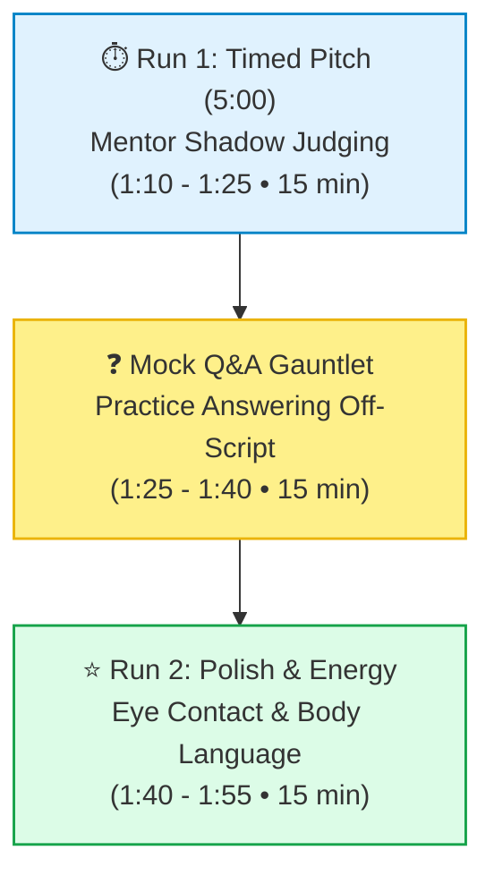
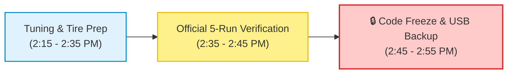
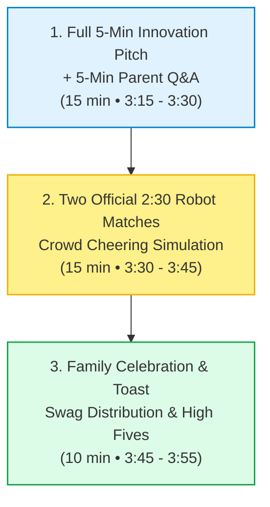

# FLL Session 9 (Sprint Session 5): Dress Rehearsal Day, Code Freeze & Family Showcase — Lego Legends

**Date:** Sunday, November 22, 2026  
**Time:** 1:00 PM – 4:00 PM (180 Minutes • Family Showcase arrives at 3:15 PM)  
**Attendees:** Team Members (9 Kids), Mentors/Coaches & Families (Parents & Siblings)  
**Season Phase:** Final Tournament Readiness Phase — Dress Rehearsal, Code Freeze & Live Crowd Simulation  

> [!IMPORTANT]
>
> ### 🧭 Coaching Architecture: The Final Dress Rehearsal Ahead of the November 29 Tournament
>
> Today is our culminating workshop before the **official November 29 tournament event**! While past sessions focused on building and testing, Session 9 is all about psychological readiness, time enforcement, and performance under pressure:
>
> 1. **Timed Innovation Rehearsal & Mock Q&A (1:10 – 1:55 PM • 45 min):** Strictly enforce the 5:00 buzzer. Practice active listening and answering judge questions organically off-script without panic.
> 2. **Code Freeze & Robot Lock (2:15 – 2:55 PM • 40 min):** Zero new code features! We only perform microscopic mechanical adjustments and starting-box alignment verification. **The code is officially frozen.**
> 3. **The Family & Friends Showcase (3:20 – 4:00 PM • 40 min):** Parents and siblings arrive to act as tournament judges and an enthusiastic crowd! The team delivers their complete 5-minute Innovation pitch, answers tough mock Q&A, and runs two official 2:30 robot matches with crowd cheering to simulate authentic tournament volume.

---

## 📌 Coach's Prep & Materials Checklist

* **Showcase Staging & Audience Setup:**
  * Welcome sign and seating chairs arranged in an arc facing the presentation board.
  * Official FLL match countdown sound effects downloaded / cued up on speakers ("3, 2, 1, LEGO!").
  * Official score sheets and clipboards for parents acting as mock judges.
  * Big screen timer visible to both speakers and drivers.
* **Tournament Gear & Code Freeze:**
  * Master tournament packing bin labeled "Team 76265 Lego Legends".
  * Verified USB backup thumb drive containing current frozen code versions.
  * Laminated run checklist card and robot starting alignment jigs.
  * First-aid repair kit: spare color sensor, spare motor, charging cables, extra Technic pins.
* **Celebration & Swag:**
  * Team buttons, stickers, and certificates ready for distribution.
  * Refreshments and light celebratory treats for families.

---

## 🕒 Master Timeline Overview (1:00 PM – 4:00 PM • 180 Min)

```mermaid
gantt
    title Session 9 Timeline (Sunday, Nov 22 • 180 Minutes)
    dateFormat HH:mm
    axisFormat %H:%M

    section Kickoff
    Arrival & Game-Day Mindset     :13:00, 10m

    section Innovation
    Timed Rehearsal & Mock Q&A     :13:10, 45m
    Core Values Circle & Warm-Up   :13:55, 10m

    section Recharge
    Bio Break & Table Reset        :14:05, 10m

    section Robot Game
    Final Tweaks & Official Code Freeze:14:15, 40m

    section Showcase Prep
    Room Staging & Welcome Setup   :14:55, 15m

    section Family Showcase
    Parents Arrive • Live Rehearsal :15:10, 40m

    section Wrap-Up
    Tournament Pack & Dismissal    :15:50, 10m
```

---

## 📋 Minute-by-Minute Session Plan

### 1:00 – 1:10 PM | Arrival, Stand-Up & Game-Day Mindset (10 min)

* **Welcome & High-Energy Greeting (3 min):** Greet every student as a tournament competitor.
* **Stand-Up Briefing (7 min):**
  * Emphasize the milestone: *Today is our dress rehearsal! In 2 hours, your families will walk through that door. We treat today exactly like tournament morning on November 29!*
  * Set the ground rule: **Encourage, celebrate, and stay calm.** If the robot slips or someone forgets a line, we support each other and keep moving!

---

### 1:10 – 1:55 PM | Block 1: Innovation Project — Timed Rehearsal & Mock Q&A (45 min)

#### 1. Full Timed Rehearsal (1:10 – 1:25 PM • 15 min)
* Start the official 5:00 countdown timer with audio chime.
* Students deliver the full pitch with physical props and trifold board.
* Mentors take notes without interrupting.
* Feedback focus:
  * Was the total time under 5 minutes? (Target: 4:30 – 4:45).
  * Did all 9 kids speak clearly and hold their props high?

#### 2. Mock Q&A Gauntlet — Answering Off-Script (1:25 – 1:40 PM • 15 min)
* Mentors fire realistic judge questions at random team members:
  * *"How did you come up with the idea for the seed pod casing?"*
  * *"What was your biggest disagreement as a team, and how did you resolve it?"* (Core Values spotlight!)
  * *"If you had another $500, what would you add to this project?"*
  * *"Who is an expert you spoke with outside of school?"*
* **Coaching Protocol:** Teach kids the **"Pass the Baton"** technique—if asked a question outside their sub-topic, smoothly invite a teammate to respond (*"Our research lead, Alakazam, tracked that data closely—Alakazam, can you share what we learned?"*).

#### 3. Energy & Polish Re-Run (1:40 – 1:55 PM • 15 min)
* Second full run incorporating vocal projection, smiling at the judges, and strong closing posture.

---

### 1:55 – 2:05 PM | Team Challenge: Core Values Activity (10 min)

* **The "Team Anchor" High-Five Huddle:**
  * Students form a tight circle with hands in the middle.
  * Practice our official team chant: *"1, 2, 3... LEGO LEGENDS!"*
  * Review what to do if a judge room feels intimidating: take a deep collective breath together, smile, and remember that judges are volunteers who want you to succeed!

---

### 2:05 – 2:15 PM | Bio Break, Snack & Table Setup (10 min)

* Quick snack and restroom break.
* Clear the table for the final robot practice window.

---

### 2:15 – 2:55 PM | Block 2: Robot Game — Code Freeze & 9-out-of-10 Consistency (40 min)

> 🛑 **OFFICIAL CODE FREEZE DECLARED AT 2:40 PM!**  
> No more code alterations, speed boosts, or motor re-calibrations. Consistency is locked in.

* **Execution Checklist:**
  * Clean drive wheels with isopropyl alcohol wipes to remove dust.
  * Run **Run 1** (M01 Drone + M03 Flip Rock): confirm 100% repeatability.
  * Run **Run 2** (M02 Exploding Seeds - 3 seeds for 30 pts + M04 Lucky Leaves): confirm mechanism trip.
  * Verify driver rotation protocol (Driver pair 1 runs Run 1 $\rightarrow$ Tags Driver pair 2 for Run 2).
* **Backup Protocol:** Export final project files to USB drive labeled `2026-11-22_TOURNAMENT_FINAL_LOCKED`.

---

### 2:55 – 3:10 PM | Setup for Family Showcase (15 min)

* **Stage the Room:**
  * Arrange seating in front of the Innovation Project board.
  * Place tournament scoreboards, brochures, and team handouts on a greeting table.
  * Position SPIKE Prime robots and mission models in tournament-ready states.
  * Assign student greeters at the doorway (**Dragonite** and **Jigglypuff**).

---

### 3:10 – 3:50 PM | Family & Friends Dress Rehearsal Showcase (40 min)

*(Parents, siblings, and family guests arrive promptly at 3:10 / 3:15 PM)*

#### 1. Innovation Presentation & Family Q&A (3:15 – 3:30 PM • 15 min)
* **The Pitch (5 min):** Team delivers their presentation to the room full of parents. Timer counts down on the big screen.
* **The Mock Q&A (5–7 min):** Parents raise their hands and ask unpredictable questions. Students practice eye contact, composure, and passing questions to teammates.
* Audience gives a huge standing ovation!

#### 2. Two Official 2:30 Robot Matches (3:30 – 3:45 PM • 15 min)
* Gather all guests around the official competition table.
* Mentors announce: *"Spectators, we need full tournament noise! Clap, cheer, and make noise when the clock starts!"*
* **Match Round 1 (2:30):** Full match run with official buzzer and referee scoring.
* **Match Round 2 (2:30):** Reset table models and run second match with driver rotation.
* Score both rounds live on the big screen using the [Scoring Calculator](../../../webtools/bioglow_calculator.html)!

#### 3. Celebration & Hard Work Recognition (3:45 – 3:55 PM • 10 min)
* Coaches address the students and families, recognizing the monumental growth from Session 1 to Session 9.
* Hand out team buttons, official competition shirts, and personalized certificates of accomplishment.

---

### 3:55 – 4:00 PM | Wrap-Up, Packing & Tournament Logistics (10 min)

* **Tournament Box Packing:**
  * Pack SPIKE Prime hubs, chargers, spare parts bins, and cables into the master tournament crate.
  * Pack trifold board, props, and script clipboards into protective travel cases.
* **Final Parent Logistics Briefing for November 29:**
  * Arrival time, venue location, spectator schedule, lunch plan, and team shirts!
* Dismiss with the official **Lego Legends** cheer!

---

## 🎯 Coach's Success & Evaluation Criteria

- [ ] Complete 5-minute Innovation pitch delivered to parent audience under the 5:00 limit.
- [ ] Team fielded multiple spontaneous parent questions using the "Pass the Baton" technique.
- [ ] Robot Game code officially frozen with master USB backup secured.
- [ ] Two complete 2:30 robot matches executed with live crowd cheering and accurate scoring.
- [ ] All tournament bins, display boards, and emergency spares packed and inventoried.
- [ ] Families briefed on tournament arrival logistics for Sunday, November 29.
