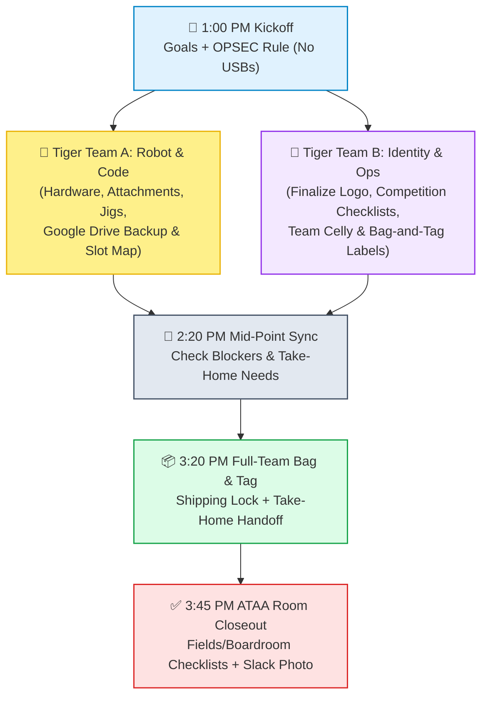

# FLL Session 9 (Pivot Plan): Tiger Team Sprint, Robot Shipping Prep & Bag-and-Tag — Lego Legends

**Date:** Sunday, November 22, 2026  
**Time:** 1:00 PM – 4:00 PM (180 Minutes)  
**Attendees:** Team Members (9 Kids) & Mentors/Coaches  
**Season Phase:** Competition Crunch & Logistics Lock — Tiger Team Execution Ahead of Tournament  

> [!IMPORTANT]
>
> ### 🧭 Coaching Pivot: Why We Changed the Plan
>
> We intentionally gave the kids extra time in earlier sessions to **brainstorm, explore, and truly learn**—which is what FLL is all about! Because of that, we are **canceling the original Family Dress Rehearsal Showcase** for today and pivoting to a focused **Tiger Team Sprint** to get our robot, code, jigs, logo, and competition gear locked and packed:
>
> 1. **Robot Ready for Shipping & Attachments Planned:** Lock the drivebase, finalize attachment designs/assignments, and build/test starting alignment jigs.
> 2. **Cloud Backup & OPSEC Discipline (NO USB Drives):** Every SPIKE Prime app saved to **Google Drive** with hub slot/app numbers documented. **Zero USB drives**—good OPSEC starts at every age!
> 3. **Logo, Competition Checklists & Team Celly:** Finalize the team logo, build/review competition checklists, and design our high-energy **Team Celly** (celebration).
> 4. **Bag and Tag + Take-Home Tiger Team Handoff:** Label, bag, and inventory every component for shipping/transport, and assign clear take-home robot prep tasks where needed.

---

## 🎯 Non-Negotiable Goals for Today (Nov 22)

- [ ] **1. Robot ready for shipping** — Chassis structurally sound, wires routed cleanly, hub charged, protective transport case/box packed.
- [ ] **2. Attachments planned out** — Every mission attachment mapped, assigned, and either built or clearly specced for take-home/final build.
- [ ] **3. Alignment jigs ready** — Starting-box jigs built, labeled, and verified against the mat wall/lines.
- [ ] **4. Apps saved in Google Drive & app numbers documented** — Latest `.llsp3` / Python files uploaded to shared team Google Drive and matched to SPIKE Hub slot numbers (`0`–`19`).
- [ ] **5. Strictly NO USB drives (OPSEC)** — All transfers via Google Drive / GitHub only; teach kids *why* unknown/unmanaged USB sticks are a security risk.
- [ ] **6. Checklists for competition ready** — Pit setup, pre-match inspection, battery/charging, and packing checklists reviewed and printed.
- [ ] **7. Finalize team logo** — Lock final logo file for shirts, pit signage, stickers/buttons, and presentation materials.
- [ ] **8. Bag and tag** — Every robot module, attachment, jig, cable, charger, and spare part bagged, labeled with Team `#76265`, and checked off.

---

## 📌 Coach's Prep & Materials Checklist

* **Robot & Shipping Prep:**
  * Shipping/transport crate or padded box labeled **"FLL Team #76265 Lego Legends"**.
  * Ziploc / resealable bags (quart & gallon) + permanent markers + masking tape / shipping tags for **Bag and Tag**.
  * Spare Technic pins, axles, beams, spare color sensor, spare motor, and SPIKE Prime charging cables.
  * Laptop(s) signed into the **Team Google Drive** folder *(NO USB thumb drives!)*.
* **Checklists & Admin:**
  * Printed [Competition Mentor CRM Checklist](../guides/mentor_competition_crm_checklist.md) and match/pit checklists.
  * Printed ATAA end-of-session room closeout sheets: [Playing Fields Checklist](../../checklists/playing_fields_checklist.html) & [Boardroom Checklist](../../checklists/boardroom_checklist.html).
* **Logo & Creative Supplies:**
  * Laptop/tablet with logo drafts for final sign-off.
  * Whiteboard / markers for **Team Celly** brainstorming.

---

## 🕒 Master Timeline Overview (1:00 PM – 4:00 PM • 180 Min)

```mermaid
gantt
    title Session 9 Tiger Team Sprint (Sunday, Nov 22 • 180 Minutes)
    dateFormat HH:mm
    axisFormat %H:%M

    section Kickoff
    Stand-Up, OPSEC Brief & Tiger Team Split :13:00, 15m

    section Sprint 1 (Parallel Tiger Teams)
    Team A - Robot, Attachments & Jigs       :13:15, 65m
    Team B - Logo, Checklists & Team Celly   :13:15, 65m

    section Recharge
    Bio Break & Mid-Point Sync               :14:20, 15m

    section Sprint 2 (Lock & Backup)
    Team A - Google Drive Backup & Slot Map  :14:35, 45m
    Team B - Bag & Tag Prep + Celly Rehearsal:14:35, 45m

    section Integration & Closeout
    Full-Team Bag & Tag + Take-Home Handoff  :15:20, 25m
    ATAA Room Closeout & Slack Photo Proof   :15:45, 15m
```

---

## 🐅 Tiger Team Structure (Parallel Execution)

Instead of keeping all 9 kids bottlenecked around one robot table, split into two focused Tiger Teams with clear deliverables:

---

## 📋 Minute-by-Minute Session Plan

### 1:00 – 1:15 PM | Kickoff Stand-Up, OPSEC Micro-Lesson & Team Split (15 min)

* **Set the Tone (5 min):**
  * Celebrate why we're pivoting: *We spent our earlier sessions really learning and brainstorming, which makes us a stronger team. Today is a focused pit-crew sprint to get our robot shipping-ready and our team identity locked!*
  * Review the **8 Goals for Today** on the whiteboard so every student knows what "done" looks like.
* **🛡️ OPSEC Micro-Lesson: Why NO USB Drives? (5 min):**
  * Teach kids a real-world engineering habit: *In real tech companies and security teams, plugging random or unmanaged USB drives into laptops is how malware spreads and how files get lost or overwritten.*
  * **Team Rule:** All robot apps and assets go into **Google Drive** (and GitHub) with clear version names—**never on USB sticks**.
* **Assign Tiger Teams (5 min):**
  * **Tiger Team A (Robot, Attachments, Jigs & Apps):** Builders & Coders focused on shipping readiness.
  * **Tiger Team B (Logo, Checklists, Celly & Bag-and-Tag):** Designers, Logistics Leads & Hype Crew.

---

### 1:15 – 2:20 PM | Sprint Block 1: Parallel Tiger Teams (65 min)

#### 🤖 Tiger Team A — Robot Shipping Readiness, Attachments & Jigs
* **Robot Base Inspection (20 min):**
  * Check all structural pins, cable routing, sensor mounting, and wheel stability so nothing shakes loose during shipping.
  * Confirm the robot fits cleanly inside the FLL inspection area dimensions.
* **Attachment Planning & Build (25 min):**
  * List every mission run and its required attachment (quick-swap mechanism, pin points, motor port).
  * Build/reinforce priority attachments now; clearly document any attachment work assigned for **take-home robot prep**.
* **Alignment Jigs (20 min):**
  * Build and test starting-box jigs (left and/or right home areas) so drivers can place the robot identically every single match.
  * Label each jig clearly (`JIG-L`, `JIG-R`, or by Run #).

#### 🎨 Tiger Team B — Finalize Logo, Competition Checklists & Team Celly
* **Finalize Team Logo (25 min):**
  * Review final logo candidates, make any last tiny tweaks, and lock the **official final version**.
  * Export/upload final logo file to Google Drive (`Team76265_Logo_FINAL`).
* **Competition Checklists (20 min):**
  * Review and customize our competition-day checklists:
    * Pre-Match Pit Checklist (battery %, wheel wipe, jigs, attachments, hub slot check).
    * Packing & Shipping Checklist (every item accounted for).
    * Review [Competition Mentor CRM Checklist](../guides/mentor_competition_crm_checklist.md).
* **Team Celly Brainstorm! (20 min):**
  * Brainstorm and pick our signature **Team Celly** (celebration move/chant for after robot runs, high scores, and judging rooms!).
  * Keep it fun, inclusive (all 9 kids can do it together), safe in tight pit/table spaces, and full of *Gracious Professionalism*®.

---

### 2:20 – 2:35 PM | Bio Break & Mid-Point Sync (15 min)

* Quick snack and water break.
* **5-Minute Stand-Up Sync:**
  * Tiger Team A reports: What is shipping-ready vs. what needs take-home prep tonight/this week?
  * Tiger Team B unveils the **final team logo** for quick full-team thumbs-up!

---

### 2:35 – 3:20 PM | Sprint Block 2: Cloud Backup, Slot Mapping & Bag-and-Tag Prep (45 min)

#### 🤖 Tiger Team A — Google Drive Backup & App Slot Documentation
* Save every SPIKE Prime project cleanly into the shared **Team Google Drive** folder using clear naming (`Run01_MissionName_v1.llsp3`).
* **Verify NO USB drives** are used anywhere in the workflow.
* Download/verify each program onto the SPIKE Prime Hub and record its exact **Hub Slot Number** below (and print/tape a copy to the pit binder!):

| Hub Slot # | Program / App Name | Missions Covered | Attachment / Jig Needed | Saved in Google Drive? | Verified on Hub? |
| :---: | :--- | :--- | :--- | :---: | :---: |
| **0** | | | | [ ] | [ ] |
| **1** | | | | [ ] | [ ] |
| **2** | | | | [ ] | [ ] |
| **3** | | | | [ ] | [ ] |
| **4** | | | | [ ] | [ ] |
| **5** | | | | [ ] | [ ] |

#### 🎨 Tiger Team B — Bag-and-Tag Station Setup & Team Celly Practice
* Prep labeled Ziploc bags and tags (`Team #76265 — [Item Name] — [Run #]`) for every attachment, jig, cable, sensor, and spare parts kit.
* Print/organize competition checklists into a pit folder or clipboard.
* Teach and rehearse the **Team Celly** so it's crisp and ready for the full team!

---

### 3:20 – 3:45 PM | Full-Team Bag & Tag, Take-Home Handoff & Team Celly (25 min)

* **📦 Bag and Tag Protocol (15 min):**
  * Every item goes into a labeled bag and gets checked off before going into the shipping/transport crate (or into a tracked take-home kit):
    - [ ] **Main Robot Chassis** (hub charged, battery seated, packed with padding)
    - [ ] **All Attachments** (individually bagged & tagged by Run # / Mission)
    - [ ] **Alignment Jigs** (bagged & tagged `JIG-L` / `JIG-R`)
    - [ ] **Chargers & Cables** (labeled with Team `#76265`)
    - [ ] **Emergency Spare Parts Kit** (pins, axles, beams, spare sensor/motor)
    - [ ] **Competition Checklists & App Slot Sheet** (in pit folder)
* **🏠 Take-Home Tiger Team Assignments (5 min):**
  * Clearly record **who** is taking home any robot/attachment kit, **what exact parts** are leaving the room, and **when** it comes back so nothing goes missing.
* **🎉 First Full-Team Celly! (5 min):**
  * Tiger Team B teaches all 9 kids the new **Team Celly** and runs it together at full energy!

---

### 3:45 – 4:00 PM | ATAA Room Closeout & Dismissal (15 min)

* Run the official ATAA end-of-session closeout checklists (Student Lead checks first, Mentor verifies):
  * [🏟️ FLL Playing Fields Checklist](../../checklists/playing_fields_checklist.html) (check F1 & F2, broken elements fixed, floors swept, tables/chairs reset)
  * [🪑 Boardroom Checklist](../../checklists/boardroom_checklist.html) (food/crumbs check, chairs, coasters, phone/wires, lights)
* **Take photo proof** of completed checklists + rooms and post to the ATAA Slack channel before leaving!

---

## 🎯 Coach's End-of-Day Success Criteria

- [ ] Robot base is structurally verified and ready for shipping/transport.
- [ ] All mission attachments are planned out and assigned (built or assigned for take-home prep).
- [ ] Starting alignment jigs are built, tested, and labeled.
- [ ] All SPIKE Prime apps are backed up in **Google Drive** with hub slot numbers documented.
- [ ] **Zero USB drives** used — OPSEC rule reinforced with the whole team.
- [ ] Competition checklists are finalized and packed.
- [ ] Team logo is officially finalized and saved in Google Drive.
- [ ] All gear is **bagged and tagged** (and any take-home kits logged).
- [ ] Team Celly brainstormed and practiced!
