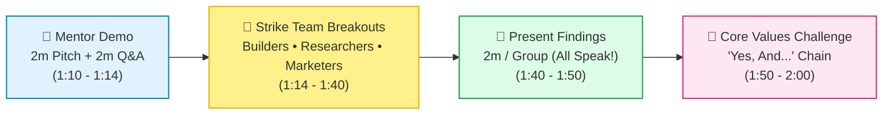
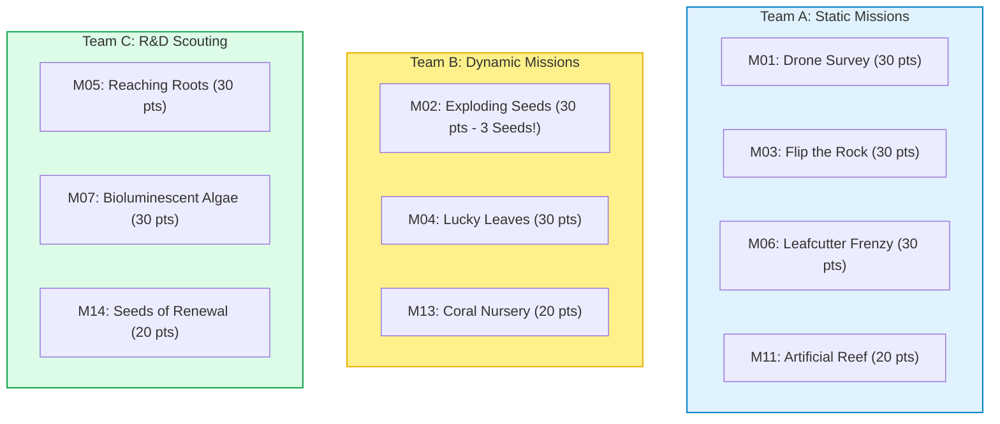

# FLL Session 5 (Sprint Session 1): Strike Team Breakouts, Digital Logo Prototypes & 3-Track Robot Missions — Lego Legends

**Date:** Sunday, October 25, 2026  
**Time:** 1:00 PM – 4:00 PM (180 Minutes)  
**Attendees:** Team Members (9 Kids), Mentors & Coaches  
**Season Phase:** Competition Build Sprint Phase — Rapid Prototyping, Strategy Specialization & Mission Coding  

> [!IMPORTANT]
>
> ### 🧭 Coaching Architecture: Moving from Discovery into Parallel Execution
>
> Today kicks off our high-gear 5-session sprint leading up to the **November 29 Tournament Event**. With only 5 in-person meetings remaining before game day, we transition from open-ended exploration into structured, parallel execution.
>
> 1. **Innovation Strike Teams (1:10 – 2:00 PM):** After a mentor demonstration modeling a concise pitch and confident Q&A, the squad splits into 3 specialized strike teams (Builders, Researchers, Marketers) to tackle parallel project tracks. Every single student must speak in the final share-out!
> 2. **Team Identity & Branding (2:00 – 2:10 PM):** Review coach-provided digital logo mockups and gather team feedback on custom color palettes, typography, and symbol tweaks.
> 3. **3-Track Robot Game Sprints (2:20 – 3:50 PM):** 90 minutes of dedicated robot table work split across Team A (Static missions), Team B (Dynamic missions), and Team C (R&D scouting), rotating roles every 15 minutes. The mantra is **reliable points, not perfection**!

---

## 📌 Coach's Prep & Materials Checklist

* **Innovation Project Materials:**
  * Whiteboard, dry-erase markers, sticky notes, and timer display.
  * Research binders, articles on paper usage, defaunation, and forest biodiversity.
  * Prototype materials: cardboard, craft foam, pipe cleaners, LEGO Technic beams, rubber bands, glue dots.
  * [Innovation Project Worksheets](../../../marketing/handouts/innovation_project_worksheet.html) and [Deforestation Worksheets](../../../marketing/handouts/deforestation_project_worksheet.html).
* **Team Branding Materials:**
  * Digital display/laptop showing coach-designed logo concept variations for "Lego Legends".
  * Color swatch cards and feedback tally sheet.
* **Robot Game Station:**
  * Official BIOGLOW competition mat and verified mission model setup.
  * 2 SPIKE Prime hubs with fully charged battery packs + charging cables on standby.
  * 2 programming tablets/laptops with SPIKE Prime app open.
  * [Scoring Calculator](../../../webtools/bioglow_calculator.html) open on tablet for score tracking.
  * Notebook for recording run times and reliability percentages.

---

## 🕒 Master Timeline Overview (1:00 PM – 4:00 PM • 180 Min)

```mermaid
gantt
    title Session 5 Timeline (Sunday, Oct 25 • 180 Minutes)
    dateFormat HH:mm
    axisFormat %H:%M

    section Kickoff
    Arrival, Stand-Up & Goals      :13:00, 10m

    section Innovation
    Mentor Demo & Modeling         :13:10, 4m
    Strike Team Breakouts          :13:14, 26m
    Group Findings (All Speak)     :13:40, 10m
    Core Values Team Challenge     :13:50, 10m

    section Identity
    Digital Logo Prototype Review  :14:00, 10m

    section Recharge
    Bio Break & Snack Reset        :14:10, 10m

    section Robot Game
    3-Track Mission Coding (90m)   :14:20, 90m

    section Wrap-Up
    Pack-Up, LEGO Sort & Shout-Outs :15:50, 10m
```

---

## 📋 Minute-by-Minute Session Plan

### 1:00 – 1:10 PM | Arrival, Stand-Up & Kickoff (10 min)

* **Welcome & High-Fives (3 min):** Fast energy check-in. Students put bags in cubbies and grab their team lanyards.
* **Stand-Up Circle & Sprint Goals (7 min):**
  * Announce the countdown: *"We have exactly 5 sessions before our November 29 competition showcase! Today is about focused teamwork and reliable execution."*
  * **Goal 1 (Innovation):** Launch our 3 Strike Teams (Builders, Researchers, Marketers) with every team member speaking during presentations.
  * **Goal 2 (Identity):** Critique and refine our official team logo.
  * **Goal 3 (Robot Game):** 90 minutes of parallel mission coding across 3 tracks (Team A, Team B, Team C), prioritizing repeatability over flashiness.
  * Review role assignments with **Machamp** (Timer Lead) and **Psyduck** (Inclusion & Stress Spotter).

---

### 1:10 – 2:00 PM | Block 1: Innovation Project (50 min)

#### 1. Mentor Demo (1:10 – 1:14 PM • 4 min)
* Two mentors deliver a model presentation:
  * **2-Minute Pitch:** Crisp introduction, problem statement (deforestation & habitat fragmentation), innovative solution, and domain expert feedback.
  * **2-Minute Mock Q&A:** Mentors demonstrate how to handle judge questions—passing questions to teammates smoothly (*"Great question, our lead researcher can answer that..."*) rather than interrupting or talking over one another.

#### 2. Strike Team Breakouts (1:14 – 1:40 PM • 26 min)
Students break into 3 designated strike teams *(Note: Teams will swap roles next session!)*:

* **Group 1: The Builders (Physical Prototypes)**
  * *Lead:* **Tinkaton** (Prototype Lead).
  * *Focus:* Build physical mockups of the proposed solution (e.g., biodegradable seed drop pod, sensor-rigged wildlife canopy corridor, or compostable packaging sample).
  * *Deliverable:* A tangible 3D proof-of-concept that can be held and demonstrated during the presentation.

* **Group 2: The Researchers (Paper Usage & Biodiversity Data)**
  * *Lead:* **Alakazam** (Research Lead).
  * *Focus:* Deep-dive into statistics on industrial paper consumption, local native tree survival rates, and biodiversity loss.
  * *Deliverable:* 3 hard facts/citations formatted as high-impact callout cards for our presentation board.

* **Group 3: The Marketers (Slogans, Themes & Hooks)**
  * *Lead:* **Dragonite** (Outreach Coordinator) & **Jigglypuff** (Creative Director).
  * *Focus:* Brainstorm catchy project titles, memorable slogans, opening hooks, and audience engagement elements.
  * *Deliverable:* 2 strong project title options, a 10-second elevator pitch hook, and proposed presentation theme.

#### 3. Present Findings (1:40 – 1:50 PM • 10 min)
* Each group gets **2 minutes to present + 1–2 minutes Q&A**.
* **STRICT RULE:** *Every student in the group must speak at least once.*
* Mentors practice gentle, supportive timer management. Teammates applaud each group.

#### 4. Team Challenge: Core Values Activity (1:50 – 2:00 PM • 10 min)
* **The "Yes, And..." Solution Improv Challenge:**
  * Students stand in a circle. One student offers a feature idea for our project: *"What if our seed pods had natural chili powder to repel squirrels?"*
  * The next student must respond: *"YES, AND... we can make the casing from recycled pressed fallen leaves!"*
  * *Coaching takeaway:* Reinforce **Plus'ing** and psychological safety—building on ideas rather than shutting them down with *"No, but..."*.

---

### 2:00 – 2:10 PM | Block 2: Team Identity & Logo Prototypes (10 min)

* **Coach Presentation:** Display 3 digital logo concepts for **"Lego Legends"** (incorporating BIOGLOW bioluminescent teal, neon lime, robotics gear, and team mascot motifs).
* **Feedback Round:** Students discuss:
  * Which color combinations stand out best from 10 feet away?
  * What typography feels energetic and legible?
  * What tweaks or personalized touches should be added before the final vote next week?
* **Jigglypuff** records team notes for the final graphic revisions.

---

### 2:10 – 2:20 PM | Bio Break, Snack & Physical Reset (10 min)

* Mandatory hands-off-screens break.
* Healthy snack, water refill, and bathroom visit.
* Prep the robot table, download fresh code projects, and align mission models.

---

### 2:20 – 3:50 PM | Block 3: Robot Game — 3-Track Mission Coding (90 min)

> 💡 **Core Mantra: Reliable Points, Not Perfection!**  
> An 80-point run that succeeds 9 times out of 10 always beats a theoretical 150-point run that fails under competition pressure. Build consistent routines!

#### Squad Breakdown & 15-Minute Role Rotations
Teams work simultaneously with roles rotating every ~15 minutes (Coder $\leftrightarrow$ Builder $\leftrightarrow$ Mat Tester / Scorekeeper):

* **Team A (Static Missions — Push, Flip & Drop):**
  * *Assigned Missions:* **M01** (Drone Survey - 30 pts), **M03** (Flip the Rock - 30 pts), **M06** (Leafcutter Frenzy - 30 pts), **M11** (Artificial Reef - 20 pts).
  * *Focus:* Simple, reliable physical pushers and passive bumpers. Code straight drives with gyro-assisted stabilization.
  * *Key Milestone:* Achieve a clean 3-consecutive-run completion of M01 and M03.

* **Team B (Dynamic Missions — Trigger & Release Mechanisms):**
  * *Assigned Missions:* **M02** (Exploding Seeds - trigger stalk for all 3 seeds = 30 pts), **M04** (Lucky Leaves - 30 pts), **M13** (Coral Nursery - 20 pts).
  * *Focus:* Motorized lever arm or weighted ramp to trigger the seed release stalk on M02. Test attachment clearance and motor angles.
  * *Key Milestone:* Verify that all 3 seeds on M02 consistently pop free.

* **Team C (R&D Scouting — Pathing & Complex Actuation):**
  * *Assigned Missions:* **M05** (Reaching Roots - 30 pts), **M07** (Bioluminescent Algae - 30 pts), **M14** (Seeds of Renewal - 20 pts).
  * *Focus:* Measure wheel distances, test table angles, and prototype passive guide walls. Draft routing maps showing how these missions could combine with earlier runs.
  * *Key Milestone:* Produce a feasibility scorecard with recommended attachment designs.

---

### 3:50 – 4:00 PM | Wrap-Up, Clean-Up Sprint & Shout-Outs (10 min)

* **Clean-Up Sprint (5 min):**
  * Power down SPIKE Prime hubs and connect to chargers (**Meowth** audits).
  * Sort loose Technic beams, pins, and axle bins (**Tinkaton** leads).
  * Save all project files with standardized naming: `2026-10-25_RunA_v1`.
* **Circle Debrief & Core Values Shout-Outs (5 min):**
  * Each student gives a shout-out to a teammate who displayed great teamwork or persistence today.
  * Mentors celebrate the high energy of parallel strike teams and preview the Group Swap for Session 2 (Nov 1).

---

## 🎯 Coach's Success & Evaluation Criteria

- [ ] All 3 Innovation Strike Teams delivered their assigned output within the 26-minute sprint.
- [ ] Every single student spoke during the Innovation findings presentation.
- [ ] Team reviewed digital logo concepts and provided concrete feedback on colors and fonts.
- [ ] Team A successfully coded and tested at least 2 static missions on the table.
- [ ] Team B prototyped an attachment capable of triggering M02 (all 3 seeds released for 30 pts).
- [ ] Team C documented initial pathing and feasibility for M05, M07, and M14.
- [ ] Hubs, laptops, and field models safely stored and plugged in for charging.
