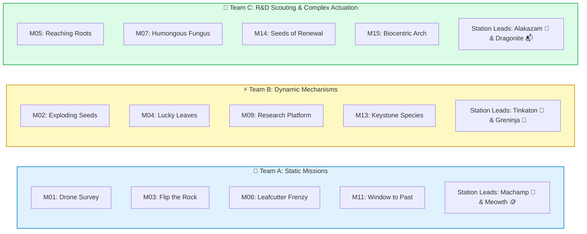

# 🤖 BIOGLOW Robot Game — Mission Status & Strategy Scoreboard

**Season:** 2026 BIOGLOW  
**Team:** FLL Team #76265 **"Lego Legends"**  
**Last Updated:** Session 5 Sprint (Oct 25, 2026) • *Pre-Session 6 Strategy Checkpoint*

---

> [!IMPORTANT]
> ### 🧭 Core Strategy Mantra: Reliable Points, Not Perfection!
> In FIRST® LEGO® League competition table matches, an **80–120 point run that succeeds 9 out of 10 times** beats a theoretical 250-point run that fails under pressure.  
> Our sprint philosophy: **Build simple, test with wall alignment jigs, and chain reliable missions into smooth multi-mission runs!**

---

## 📈 Executive Points Dashboard

<div style="display: grid; grid-template-columns: repeat(auto-fit, minmax(210px, 1fr)); gap: 0.85rem; margin: 1.25rem 0;">
  <div style="background: var(--md-code-bg-color, #1e293b); border: 2px solid #0284c7; border-radius: 10px; padding: 1rem; text-align: center; box-shadow: 0 4px 12px rgba(0,0,0,0.15);">
    <div style="font-size: 0.75rem; font-weight: 700; text-transform: uppercase; color: #38bdf8; letter-spacing: 0.5px;">🎯 Total Mat Potential</div>
    <div style="font-size: 1.85rem; font-weight: 800; color: #ffffff; margin: 0.25rem 0;">430 PTS</div>
    <div style="font-size: 0.75rem; color: #94a3b8;">15 Official Mission Models</div>
  </div>
  <div style="background: var(--md-code-bg-color, #1e293b); border: 2px solid #16a34a; border-radius: 10px; padding: 1rem; text-align: center; box-shadow: 0 4px 12px rgba(0,0,0,0.15);">
    <div style="font-size: 0.75rem; font-weight: 700; text-transform: uppercase; color: #4ade80; letter-spacing: 0.5px;">✅ Verified Working Code</div>
    <div style="font-size: 1.85rem; font-weight: 800; color: #4ade80; margin: 0.25rem 0;">40 PTS</div>
    <div style="font-size: 0.75rem; color: #94a3b8;">M01 (20 pts) + M10 Passive (20 pts)</div>
  </div>
  <div style="background: var(--md-code-bg-color, #1e293b); border: 2px solid #eab308; border-radius: 10px; padding: 1rem; text-align: center; box-shadow: 0 4px 12px rgba(0,0,0,0.15);">
    <div style="font-size: 0.75rem; font-weight: 700; text-transform: uppercase; color: #facc15; letter-spacing: 0.5px;">🧪 In Active Prototyping</div>
    <div style="font-size: 1.85rem; font-weight: 800; color: #facc15; margin: 0.25rem 0;">170 PTS</div>
    <div style="font-size: 0.75rem; color: #94a3b8;">M02, M03, M05, M07, M11, M13</div>
  </div>
  <div style="background: var(--md-code-bg-color, #1e293b); border: 2px solid #ec4899; border-radius: 10px; padding: 1rem; text-align: center; box-shadow: 0 4px 12px rgba(0,0,0,0.15);">
    <div style="font-size: 0.75rem; font-weight: 700; text-transform: uppercase; color: #f472b6; letter-spacing: 0.5px;">🏆 Tournament Target</div>
    <div style="font-size: 1.85rem; font-weight: 800; color: #ffffff; margin: 0.25rem 0;">140–180 PTS</div>
    <div style="font-size: 0.75rem; color: #94a3b8;">Across 3 Chained Match Runs</div>
  </div>
</div>

---

## 🚦 Status Legend & Color Standards

| Status Badge | Meaning & Criteria | Next Milestone Required |
| :--- | :--- | :--- |
| ✅ **Verified & Working** | Code written, jig alignment locked, tested 3 or more consecutive times on the table. | Chain into multi-mission run; practice 2.5-min reset drill. |
| 🛠️ **Mechanism Built** | Physical Technic arm, lever, or pusher constructed; awaiting SPIKE Prime code & tuning. | Write SPIKE Python / Block routines; measure wheel distances. |
| 💡 **Prototype Idea / Design** | CAD concept or sketch drafted; attachment designed off-bot. | Mount attachment onto robot chassis; test clearances. |
| 🛡️ **Passive Rule Protection** | Points scored automatically by preserving field rules (e.g. leaving animals untouched). | Ensure autonomous driving paths never clip or disturb models. |
| ⏳ **Open / Backlog** | Scoped for later sprint or dependent on prior missions (e.g. seed collection). | Complete prerequisite runs first before dedicating build time. |

---

## 📊 Master Mission Status Tracker

| Mission | Mission Name | Max Points | Current Status | Strike Team | Attachment / Mechanism | Engineering Notes & Next Steps |
| :---: | :--- | :---: | :--- | :---: | :--- | :--- |
| **M01** | Drone Survey | Max 30 (20 + 10 bonus) | ✅ **20 pts Working** | **Team A** | Passive front wedge + Wall Jig | Solid code + jig scores 20 pts. Bonus 10 pts logic written; calibrating gyro turn consistency. |
| **M02** | Exploding Seeds | Max 30 (10 per seed) | 💡 **Prototype Idea** | **Team B** | Motorized overhead lever arm | Stalk trigger prototype built; needs motor angle calibration to release all 3 seeds reliably. |
| **M03** | Flip the Rock | Max 30 (20 + 10 bonus) | 💡 **Prototype Idea** | **Team A** | Passive scoop / under-plow | Concept designed; planned to chain immediately following M01 on the North-East outbound route. |
| **M04** | Lucky Leaves | Max 30 (10 for 1st, 20 for 2nd) | ⏳ **Open** | **Team B** | Passive guide horn / hook | Low complexity; will chain directly after M02 Exploding Seeds in Run 2. |
| **M05** | Reaching Roots | Max 20 (10 partial, 20 full) | 🛠️ **Mechanism Built** | **Team C** | Rack-and-pinion extension arm | Prototypes constructed; testing motor torque and gear lash over table distance. |
| **M06** | Leafcutter Frenzy | Max 30 (10 per fragment) | ⏳ **Open** | **Team A** | Wide sweep bumper | Scouting pathing along the mat border; evaluating passive push reliability. |
| **M07** | Humongous Fungus | Max 40 (20 mycelium + 10/conn) | 🛠️ **Mechanism Built** | **Team C** | Active rotary lifting fork | Lifting mechanism assembled off-bot; table trial scheduled for Session 6. |
| **M08** | Tangled | Max 30 | ⏳ **Open** | **Team C** | Pull hook / extraction pin | Backlogged for Phase 2 optimization. |
| **M09** | Research Platform | Max 30 (10 per action) | ⏳ **Open** | **Team B** | Stepped push bar | Investigating potential shared attachment mounting with M13. |
| **M10** | Fragile Microhabitats | Max 20 (10 per animal) | 🛡️ **Passive Baseline (20 pts)** | **All Teams** | Autonomous path clearance | **Guaranteed 20 points** as long as our robot does not disturb animals. All routes must give a 2-stud buffer! |
| **M11** | Window to the Past | Max 20 | 💡 **Prototype Idea** | **Team A** | Passive flat bumper | Simple straight drive push; ready for coding sprint in Run 1 combo. |
| **M12** | Forest Elder | Max 30 (20 cane + 10 tie) | ⏳ **Open** | **Team C** | Precision latch claw | High precision required; scheduled after Run 1 & 2 combos are stabilized. |
| **M13** | Keystone Species | Max 30 | 💡 **Prototype Idea** | **Team B** | Gravity release trigger hopper | Mechanism prototyped off-bot; awaiting chassis mount and drive motor alignment. |
| **M14** | Seeds of Renewal | Max 20 (5/seed + 5 mat) | ⏳ **Open (Prereq Blocked)** | **Team C** | Seed dispenser hopper | ⚠️ **Prerequisite Dependency:** Requires seeds collected from M02 first! Do not build until M02 is 100% reliable. |
| **M15** | Biocentric Architecture | Max 40 (10/upg + 10 dock) | ⏳ **Open** | **Team C** | Dual slide / drop gate | High point potential end-game mission; candidate for final 30-second return run. |

---

## 🏃 Multi-Mission Run Combos (Strategy Architecture)

Connecting individual missions into **continuous multi-mission runs** eliminates trips back to Home and maximizes our 2.5-minute match clock!

```mermaid
flowchart TD
    subgraph Run1["🚀 Run 1: The North-East Push (Est. 50–70 pts • Target: 25s)"]
        M01["M01: Drone Survey<br/>(20-30 pts)"] --> M03["M03: Flip the Rock<br/>(20-30 pts)"]
        M03 --> M11["M11: Window to Past<br/>(20 pts)"]
        M11 --> Return1["↩️ Return to Home Launch Area"]
    end

    subgraph Run2["🌱 Run 2: Central Seed Release (Est. 50–60 pts • Target: 35s)"]
        M02["M02: Exploding Seeds<br/>(30 pts)"] --> M04["M04: Lucky Leaves<br/>(20-30 pts)"]
        M04 --> Return2["↩️ Return to Home Launch Area"]
    end

    subgraph Run3["🍄 Run 3: East Ridge & Renewal (Est. 40–60 pts • Target: 40s)"]
        M05["M05: Reaching Roots<br/>(20 pts)"] --> M07["M07: Humongous Fungus<br/>(40 pts)"]
        M07 -.->|If seeds secured| M14["M14: Seeds of Renewal<br/>(20 pts)"]
        M14 --> Return3["↩️ Final Park in Home / Dock"]
    end

    subgraph Passive["🛡️ Passive Match Protection"]
        M10["M10: Fragile Microhabitats<br/>(+20 pts untouched)"]
    end

    style Run1 fill:#e0f2fe,stroke:#0284c7,stroke-width:2px;
    style Run2 fill:#fef9c3,stroke:#ca8a04,stroke-width:2px;
    style Run3 fill:#dcfce7,stroke:#16a34a,stroke-width:2px;
    style Passive fill:#fce7f3,stroke:#db2777,stroke-width:2px;
```



### Run Breakdown & Time Budgets

* **Run 1 — North-East Push (25s):** Fast, reliable passive run. Robot pushes out along the north wall using the alignment jig, hits M01, maneuvers into M03, finishes M11, and cruises back into Home.
* **Run 2 — Central Trigger & Seeds (35s):** Active motorized run. Drives out to M02, triggers stalk with motorized lever to burst all 3 seeds, activates M04 lever, and returns.
* **Run 3 — East Ridge & Renewal (40s):** Precision run. Utilizes rack-and-pinion lifter for M05 and M07. If seed collection from Run 2 succeeded, deposits seeds into M14.
* **Transition Pacing (20s Total):** 10 seconds per attachment swap in Home using our [Pokémon CRM Checklist](../../marketing/handouts/crew_resource_management_kids.html).
* **Match Total:** Approx. 120 seconds of action, leaving a 30-second buffer for emergency resets!

---

## 👥 Strike Team Station Assignments

To keep all 9 team members productive and engaged, work is organized into **3 specialized parallel Strike Teams** (rotated weekly for cross-training):



* **Team A (Static Missions):** Masters of passive guides, bumper geometry, and gyro-straight drives.
* **Team B (Dynamic Mechanisms):** Masters of motorized gear trains, lever triggers, and drop latches.
* **Team C (R&D & Pathing):** Masters of mat coordinate mapping, complex rack systems, and end-game scoring.
* **Inclusion & Quality Lead:** **Psyduck 🦆** manages the match timer, table turn fairness, and stress resets.

---

## ⚖️ Strategic Risk vs. Reward Matrix

```text
       HIGH REWARD ▲
                   │
                   │    [M07] Fungus (40 pts)      [M15] Biocentric (40 pts)
                   │    [M02] Seeds (30 pts)       [M12] Forest Elder (30 pts)
                   │
                   │    [M01] Drone (30 pts)       [M05] Roots (20 pts)
                   │    [M03] Rock (30 pts)        [M14] Renewal (20 pts - Prereq!)
                   │    [M10] Habitats (20 pts)
                   │    [M11] Window (20 pts)
                   │
                   └────────────────────────────────────────────────────────►
                   LOW RISK / EFFORT                       HIGH RISK / COMPLEXITY
```

> [!TIP]
> **Key Takeaway for Builders & Coders:**  
> Lock in the **Low Risk / High Reward** cluster first (M01, M03, M10, M11, M02). Once our baseline reaches **100+ reliable points**, we promote the complex missions (M07, M15) into our match lineup!

---

## 🛠️ Related Tools & Engineering Handouts

* 🎮 [Interactive 3D Robot Simulator (Live App)](https://jaimeyu.github.io/fll_sim/) — Test autonomous drive paths on the virtual BIOGLOW mat!
* 🧮 [BIOGLOW Mission Scoring Calculator](../../webtools/bioglow_calculator.html) — Interactive rule-checked match calculator.
* ⏱️ [Launch Match Timer & Audio Cues](../../webtools/index.html) — Official 2.5-minute match buzzer with pit sounds.
* 🚀 [Robot Motion & Code Storyboard v2](../../marketing/handouts/mission_design_sketchpad_v2.html) — Printable 2-page engineering sketchpad with LEGO stud scales and gyro sequence logs.
* 📋 [Pokémon CRM Run Card Workshop](../../marketing/handouts/crew_resource_management_kids.html) — Co-pilot and pilot checklist builder for match play.
